<div align="center">

**UNIVERSIDAD ANÁHUAC MAYAB**

# Proyecto Ordinario

### Documentación de los proyectos (PAIF) — Entrega final

**Estructuras de Datos y Algoritmos** · NRC 50560<br>
Arreglos · Listas · Pilas · Colas · Árboles · Grafos

Docente: Lizbeth Hernández Olan

**Integrantes del equipo**<br>
Alejandro Cervera Castillo · Gael Hernández Lozano · Mario Andrés Zaldívar de la Cruz · Rodolfo Concha Canto

Repositorio: https://github.com/mariozaldivar/Ordinario-estructuras-de-datos

Mérida, Yucatán · Noviembre de 2026

</div>

---

## Índice general

0. [Introducción](#introducción)
1. [Proyecto 1 — Resistencia eléctrica](#proyecto-1--resistencia-eléctrica) · *Arreglos*
   - [1.1 Fase 1. Contextualización](#11-fase-1-contextualización)
   - [1.2 Fase 2. Definición de los requerimientos funcionales](#12-fase-2-definición-de-los-requerimientos-funcionales)
   - [1.3 Fase 3. Diseño](#13-fase-3-diseño)
   - [1.4 Fase 4. Codificación](#14-fase-4-codificación)
   - [1.5 Fase 5. Pruebas](#15-fase-5-pruebas)
2. [Proyecto 2 — Carrito de compras](#proyecto-2--carrito-de-compras) · *Listas*
   - [2.1 Fase 1. Contextualización](#21-fase-1-contextualización)
   - [2.2 Fase 2. Definición de los requerimientos funcionales](#22-fase-2-definición-de-los-requerimientos-funcionales)
   - [2.3 Fase 3. Diseño](#23-fase-3-diseño)
   - [2.4 Fase 4. Codificación](#24-fase-4-codificación)
   - [2.5 Fase 5. Pruebas](#25-fase-5-pruebas)
3. [Proyecto 3 — Navegador web](#proyecto-3--navegador-web) · *Pilas (LIFO)*
   - [3.1 Fase 1. Contextualización](#31-fase-1-contextualización)
   - [3.2 Fase 2. Definición de los requerimientos funcionales](#32-fase-2-definición-de-los-requerimientos-funcionales)
   - [3.3 Fase 3. Diseño](#33-fase-3-diseño)
   - [3.4 Fase 4. Codificación](#34-fase-4-codificación)
   - [3.5 Fase 5. Pruebas](#35-fase-5-pruebas)
4. [Proyecto 4 — Cola de impresión](#proyecto-4--cola-de-impresión) · *Colas (FIFO)*
   - [4.1 Fase 1. Contextualización](#41-fase-1-contextualización)
   - [4.2 Fase 2. Definición de los requerimientos funcionales](#42-fase-2-definición-de-los-requerimientos-funcionales)
   - [4.3 Fase 3. Diseño](#43-fase-3-diseño)
   - [4.4 Fase 4. Codificación](#44-fase-4-codificación)
   - [4.5 Fase 5. Pruebas](#45-fase-5-pruebas)
5. [Proyecto 5 — Sistema de archivos](#proyecto-5--sistema-de-archivos) · *Árbol binario de búsqueda*
   - [5.1 Fase 1. Contextualización](#51-fase-1-contextualización)
   - [5.2 Fase 2. Definición de los requerimientos funcionales](#52-fase-2-definición-de-los-requerimientos-funcionales)
   - [5.3 Fase 3. Diseño](#53-fase-3-diseño)
   - [5.4 Fase 4. Codificación](#54-fase-4-codificación)
   - [5.5 Fase 5. Pruebas](#55-fase-5-pruebas)
6. [Proyecto 6 — Ruta mágica](#proyecto-6--ruta-mágica) · *Grafos (Dijkstra)*
   - [6.1 Fase 1. Contextualización](#61-fase-1-contextualización)
   - [6.2 Fase 2. Definición de los requerimientos funcionales](#62-fase-2-definición-de-los-requerimientos-funcionales)
   - [6.3 Fase 3. Diseño](#63-fase-3-diseño)
   - [6.4 Fase 4. Codificación](#64-fase-4-codificación)
   - [6.5 Fase 5. Pruebas](#65-fase-5-pruebas)
7. [Referencias bibliográficas](#referencias-bibliográficas)

---

# Introducción

Este documento reúne la documentación de los seis proyectos del Proyecto Ordinario de *Estructuras de Datos y Algoritmos*. Cada proyecto resuelve un problema con una estructura de datos distinta y se documenta con las cinco fases de la guía: **Contextualización**, **Requerimientos funcionales**, **Diseño**, **Codificación** y **Pruebas**.

| # | Proyecto | Estructura | Versiones | Tecnologías |
|---|---|---|---|---|
| 1 | Resistencia eléctrica | Arreglos | Consola y web | Python · HTML/CSS/JS |
| 2 | Carrito de compras | Listas | Consola y web | Python + `rich` · HTML/CSS/JS |
| 3 | Navegador web | Pilas | Web | HTML/CSS/JS |
| 4 | Cola de impresión | Colas | Web (*fullstack*) | FastAPI · React + Vite |
| 5 | Sistema de archivos | Árbol binario de búsqueda | Consola y web | Python + `rich` · HTML/CSS/JS/SVG |
| 6 | Ruta mágica | Grafos | Consola y web | Python + `rich` · HTML/CSS/JS/SVG |

En los proyectos con dos versiones, la lógica (clases y algoritmos) se programó primero en Python. Después se tradujo a JavaScript para la interfaz gráfica, que añade métodos de apoyo para dibujar y animar. Las figuras se numeran por proyecto: la *Figura 5.3* es la tercera del Proyecto 5. Todas las evidencias son capturas de ejecuciones reales de los programas.

Todo el código fuente está en el repositorio indicado en la portada, en una carpeta por proyecto.

# Proyecto 1 — Resistencia eléctrica

> **Estructura de datos:** Arreglos · **Carpeta en el repositorio:** `traductor-resistencias/`

## 1.1 Fase 1. Contextualización

### ¿Qué se debe hacer?

Un programa que, a partir del valor de una resistencia en ohmios, obtenga la combinación de colores de sus bandas según la norma IEC 60062:2016. También debe calcular la resistencia equivalente de *n* resistencias conectadas **en serie** y **en paralelo**. El equipo hizo dos versiones con la misma lógica:

- **Versión de consola (Python):** lee el tipo de circuito y los valores de las resistencias. Imprime la combinación de colores de cada una y la resistencia equivalente.
- **Versión gráfica (HTML + JavaScript):** dibuja la resistencia con sus bandas coloreadas mientras el usuario escribe el valor. Permite agregar resistencias a un circuito y muestra los totales en serie y en paralelo.

### ¿Qué se necesita?

- Una clase que represente una **resistencia** y sepa convertir su magnitud en bandas de colores.
- Una clase que represente el **circuito**, guarde sus resistencias en un **arreglo** y calcule la resistencia equivalente con las fórmulas:
  - Serie: `Rts = R1 + R2 + … + Rn`
  - Paralelo: `Rtp = 1 / (1/R1 + 1/R2 + … + 1/Rn)`
- Una tabla de colores, modelada como arreglo, que relacione cada color con su dígito y su multiplicador.
- Validación de entradas: tipo de circuito válido, valores numéricos y no negativos.

### ¿Qué elementos se identifican?

| Elemento | Descripción |
|---|---|
| Valor de la resistencia | Magnitud en ohmios (Ω) que escribe el usuario. |
| Dígitos significativos | Los dos primeros dígitos del valor (1.ª y 2.ª banda). |
| Multiplicador | Potencia de 10 que representa la 3.ª banda (cantidad de dígitos restantes). |
| Tabla de colores | Negro (0, ×1) … Blanco (9, ×10⁹), guardada en un arreglo. |
| Combinación de colores | Arreglo de tres bandas que representa el valor. |
| Circuito | Tipo (serie o paralelo) y arreglo de resistencias. |
| Resistencia equivalente | Resultado de aplicar la fórmula del tipo de circuito. |
| Representación gráfica | Dibujo SVG de la resistencia con las bandas coloreadas (versión web). |

---

## 1.2 Fase 2. Definición de los requerimientos funcionales

| ID | Requerimiento | Versión |
|---|---|---|
| R1 | Convertir el valor de una resistencia a colores | Consola y web |
| R2 | Mostrar los colores en modo gráfico | Web |
| R3 | Calcular la resistencia equivalente en serie | Consola y web |
| R4 | Calcular la resistencia equivalente en paralelo | Consola y web |
| R5 | Validar las entradas del usuario | Consola y web |

| | |
|---|---|
| **Nombre** | R1 – Convertir el valor de una resistencia a colores |
| **Descripción** | Toma los dos primeros dígitos del valor como 1.ª y 2.ª banda y la cantidad de dígitos restantes como multiplicador (3.ª banda). Cada número se busca en el arreglo de colores IEC 60062:2016. |
| **Entrada** | Valor en ohmios. Ej.: `160`, `5800`, `47000` |
| **Salidas** | Nombres de las bandas. Ej.: `160` → Marrón, Azul, Marrón; `5800` → Verde, Gris, Rojo; `47000` → Amarillo, Violeta, Naranja |

| | |
|---|---|
| **Nombre** | R2 – Mostrar los colores en modo gráfico |
| **Descripción** | Mientras el usuario escribe, la versión web colorea las cuatro bandas de un dibujo SVG. La cuarta banda (tolerancia) se pinta dorada o plateada según cuánto valor se pierde al redondear a dos cifras significativas. |
| **Entrada** | Valor en ohmios escrito en la barra |
| **Salidas** | Dibujo de la resistencia con sus bandas coloreadas |

| | |
|---|---|
| **Nombre** | R3 – Calcular la resistencia equivalente en serie |
| **Descripción** | Suma las magnitudes de todas las resistencias del arreglo del circuito: `Rts = R1 + R2 + … + Rn`. |
| **Entrada** | Tipo `series` y *n* valores (consola) o resistencias agregadas al circuito (web) |
| **Salidas** | Resistencia equivalente en Ω. Ej.: 160 + 5800 + 47000 + 220 = **53 180 Ω** |

| | |
|---|---|
| **Nombre** | R4 – Calcular la resistencia equivalente en paralelo |
| **Descripción** | Suma los recíprocos de las magnitudes y devuelve el recíproco de esa suma: `Rtp = 1 / (1/R1 + … + 1/Rn)`. No admite que todas las resistencias valgan 0 Ω, porque 1/0 no está definido. |
| **Entrada** | Tipo `parallel` y *n* valores (consola) o resistencias agregadas al circuito (web) |
| **Salidas** | Resistencia equivalente en Ω. Ej.: 160 ∥ 5800 ∥ 47000 ∥ 220 = **90.999 Ω** |

| | |
|---|---|
| **Nombre** | R5 – Validar las entradas del usuario |
| **Descripción** | Rechaza tipos de circuito distintos de `series`/`parallel`, valores no numéricos y valores negativos. Muestra un mensaje de error y vuelve a pedir el dato sin terminar el programa. Los valores que no se pueden representar con colores (menores a 10 Ω o con decimales) se marcan con `?`. |
| **Entrada** | `paralelo`, `abc`, `-3`, `5`, `12.5` |
| **Salidas** | `ERROR: The circuit type 'paralelo' is not valid…`, `ERROR: Value is not numeric, try again`, `ERROR: The resistor magnitude -3.0 is invalid…`, `5.0 ohms = ?` |

---

## 1.3 Fase 3. Diseño

### Versión de consola (Python)

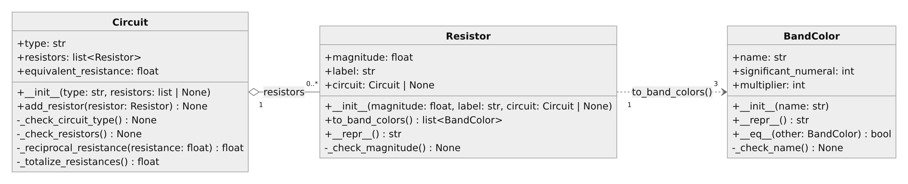

| Clase | Atributos | Métodos |
|---|---|---|
| **Circuit** | `type: str`<br>`resistors: list[Resistor]`<br>`equivalent_resistance: float` | `add_resistor(resistor)`<br>`_check_circuit_type()`<br>`_check_resistors()`<br>`_reciprocal_resistance(resistance) → float`<br>`_totalize_resistances() → float` |
| **Resistor** | `magnitude: float`<br>`label: str`<br>`circuit: Circuit \| None` | `to_band_colors() → list[BandColor]`<br>`_check_magnitude()`<br>`__repr__() → str` |
| **BandColor** | `name: str`<br>`significant_numeral: int`<br>`multiplier: int` | `_check_name()`<br>`__repr__() → str`<br>`__eq__(other) → bool` |

**Relaciones:** `Circuit` agrega de 0 a *n* objetos `Resistor` en el arreglo `resistors`. `Resistor` usa `BandColor` para construir el arreglo de tres bandas. No hay herencia.

### Versión gráfica (JavaScript)

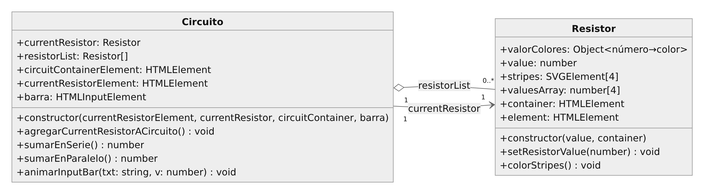

| Clase | Atributos | Métodos |
|---|---|---|
| **Resistor** | `valorColores` (dígito → color)<br>`value: number`<br>`stripes: SVGElement[4]`<br>`valuesArray: number[4]`<br>`container`, `element` | `setResistorValue(number)`<br>`colorStripes()` |
| **Circuito** | `resistorList: Resistor[]`<br>`currentResistor: Resistor`<br>`circuitContainerElement`, `currentResistorElement`, `barra` | `agregarCurrentResistorACircuito()`<br>`sumarEnSerie() → number`<br>`sumarEnParalelo() → number`<br>`animarInputBar(txt, v)` |

---

## 1.4 Fase 4. Codificación

### Tecnologías y archivos

| Versión | Archivos | Tecnologías |
|---|---|---|
| Consola | `version-cli/classes.py`, `main.py`, `user_input.py`, `pretty_print.py` | Python 3.14 (sin dependencias externas) |
| Web | `index.html`, `resistor.js`, `styles.css` | HTML5, CSS3, JavaScript (SVG) |

### Uso de arreglos

- El circuito guarda sus resistencias en un arreglo (`self.resistors` en Python, `this.resistorList` en JavaScript). Las sumas lo recorren.
- La tabla de colores es un arreglo de objetos `BandColor` (Python) o un objeto indexado por dígito (`valorColores`, JavaScript).
- La combinación resultante es un arreglo de tamaño fijo: `color_combination = [None, None, None]` en Python y `valuesArray = [d1, d2, multiplicador, tolerancia]` en JavaScript.

### Fórmulas

```python
# Serie y paralelo (Circuit._totalize_resistances)
match self.type:
    case "series":
        equivalent_resistance = sum(resistances)
    case "parallel":
        equivalent_resistance = 1 / sum(map(self._reciprocal_resistance, resistances))
```

```python
# Bandas (Resistor.to_band_colors): dos dígitos significativos + multiplicador
first_band = int(str(self.magnitude)[0])
second_band = int(str(self.magnitude)[1])
multiplier = 10 ** len(str(int(self.magnitude))[2:])
```

### Condicionales y validaciones

```python
if self.magnitude != round(self.magnitude):
    raise ValueError("... not supported for resistances with decimal points")
if self.magnitude < 10:
    raise ValueError("... not supported for resistances below 10 ohms")
if log10(multiplier) > 9:
    raise ValueError("... too big to be represented as an IEC-60062:2016 color combination")
```

```js
// Versión web: la cuarta banda indica si se perdió más del 5 % del valor al redondear
if (parseFloat(leftover) > parseFloat(numberString) / 20) { /* plateada */ } else { /* dorada */ }
```

### Documentación del código

Las clases de Python tienen *docstrings* con sus atributos, sus métodos públicos y sus limitaciones (por ejemplo, `Resistor` y `Circuit` en `classes.py`). La función de salida `pretty_print_circuit_information` documenta sus parámetros.

### Instalación y uso

**Consola**

1. Instale Python 3.14.
2. Entre a la carpeta `version-cli` y ejecute:

   ```shell
   python3 main.py
   ```

3. Escriba el tipo de circuito (`series` o `parallel`) y luego un valor por línea. Para terminar, presione `Ctrl + D`.

**Web:** abra `index.html` en el navegador o entre a la página publicada del proyecto. Escriba un valor y presione **Agregar resistencia al circuito**.

### Limitaciones

- No se convierten a colores los valores menores a 10 Ω ni los que tienen decimales (en consola se muestran con `?`).
- Se usan dos cifras significativas: un valor como 165 Ω se representa como 160 Ω (en la web, la cuarta banda plateada avisa que se perdió más del 5 %).
- No se aceptan prefijos (*kilo*, *mega*); el valor se escribe completo en ohmios.

---

## 1.5 Fase 5. Pruebas

| Requerimiento | Prueba | Resultado esperado | Resultado | Evidencia |
|---|---|---|---|---|
| R1 | 160, 5800, 47000, 220 | Marrón-Azul-Marrón, Verde-Gris-Rojo, Amarillo-Violeta-Naranja, Rojo-Rojo-Marrón | ✅ Cumple | Fig. 1.1, 1.4 |
| R2 | Escribir 160 y 5800 en la web | Bandas coloreadas en el dibujo | ✅ Cumple | Fig. 1.4, 1.5 |
| R3 | Serie de los 4 valores | 53 180 Ω | ✅ Cumple | Fig. 1.1, 1.6 |
| R4 | Paralelo de los 4 valores | ≈ 90.999 Ω | ✅ Cumple | Fig. 1.2, 1.6 |
| R5 | `paralelo`, `abc`, `-3`, `5`, `12.5` | Mensajes de error / `?` sin cerrar el programa | ✅ Cumple | Fig. 1.1, 1.3 |

**Figura 1.1.** Consola: circuito en serie. Incluye un tipo de circuito inválido y un valor no numérico (R1, R3, R5).

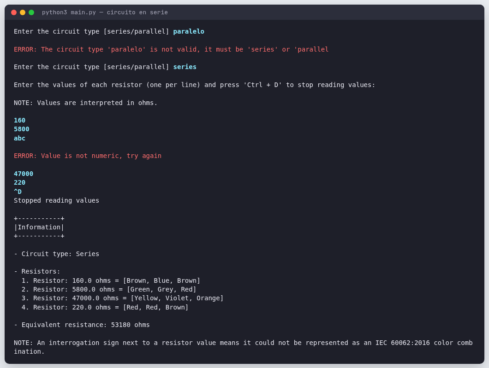

**Figura 1.2.** Consola: el mismo conjunto de resistencias en paralelo (R4).

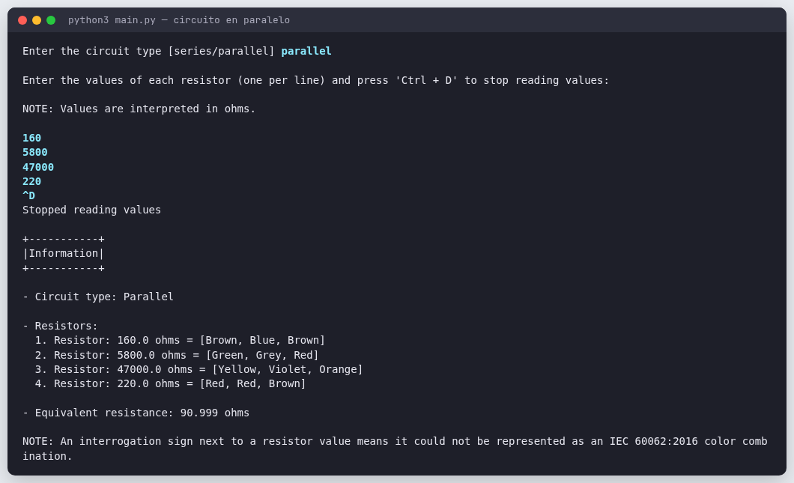

**Figura 1.3.** Consola: valores que no se pueden convertir a colores y valor negativo (R5).

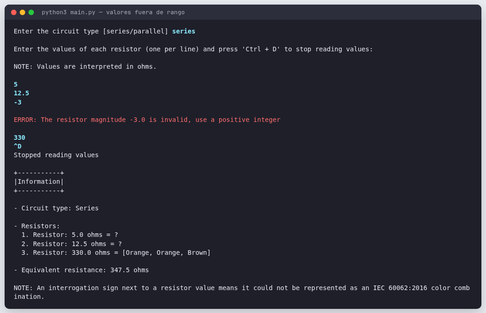

**Figura 1.4.** Web: al escribir 160 se dibuja Marrón-Azul-Marrón (R1, R2).

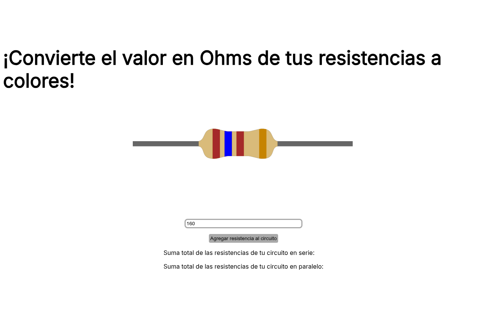

**Figura 1.5.** Web: 5800 Ω se dibuja Verde-Gris-Rojo (R1, R2).

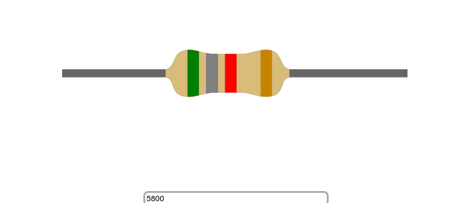

**Figura 1.6.** Web: circuito con 160, 5800, 47000 y 220 Ω. Totales en serie (53 180 Ω) y en paralelo (90.9989 Ω), iguales a los de la consola (R3, R4).

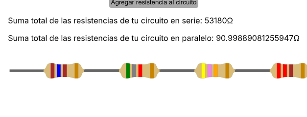

**Conclusión:** las dos versiones dan los mismos colores y los mismos totales para las mismas entradas, y los totales coinciden con el cálculo a mano.

---

# Proyecto 2 — Carrito de compras

> **Estructura de datos:** Listas · **Carpeta en el repositorio:** `carrito-de-compras/`

## 2.1 Fase 1. Contextualización

### ¿Qué se debe hacer?

Simular un carrito de compras que use **listas** como estructura principal. El usuario debe poder consultar un catálogo, buscar productos y agregarlos al carrito. También debe poder ver el carrito con subtotales y total, cambiar cantidades, eliminar productos, vaciar el carrito y finalizar la compra. Todo se guarda en memoria, sin base de datos. Hay dos versiones:

- **Consola (Python):** menú numerado de 9 opciones con tablas en la terminal (librería `rich`).
- **Web (HTML + JavaScript):** catálogo en tarjetas, carrito editable y ticket de compra. Reutiliza las clases del equipo traducidas a JavaScript.

### ¿Qué se necesita?

- Una clase **Producto** con ID, nombre, categoría y precio.
- Una lista **Catálogo** precargada con los productos y búsqueda por ID.
- Una lista **Carrito** cuyos elementos (**renglones**) guardan producto, cantidad y subtotal.
- Operaciones de inserción, búsqueda, actualización y eliminación sobre la lista del carrito.
- Validación de entradas: IDs fuera de rango, cantidades no positivas o no numéricas y opciones de menú inválidas.

### ¿Qué elementos se identifican?

| Elemento | Descripción |
|---|---|
| Producto | `id`, `nombre`, `categoría`, `precio`. |
| Catálogo | Lista con 5 productos precargados (Teclado, Mouse, Monitor, Audífonos, Memoria USB). |
| Renglón del carrito | Producto + cantidad + subtotal (`precio × cantidad`). |
| Carrito | Lista de renglones. |
| Total | Suma de los subtotales del carrito. |
| Artículos | Suma de las cantidades del carrito. |
| Menú | Opciones 1–9 que llaman a cada operación (versión de consola). |

---

## 2.2 Fase 2. Definición de los requerimientos funcionales

| ID | Requerimiento |
|---|---|
| R1 | Catálogo precargado |
| R2 | Mostrar el catálogo completo |
| R3 | Buscar producto por ID |
| R4 | Agregar producto al carrito |
| R5 | Ver el carrito con subtotales y total |
| R6 | Modificar la cantidad de un producto |
| R7 | Eliminar un producto del carrito |
| R8 | Vaciar el carrito |
| R9 | Finalizar la compra |
| R10 | Validar entradas y salir del programa |

| | |
|---|---|
| **Nombre** | R1 – Catálogo precargado |
| **Descripción** | Al iniciar, la clase `Catalogue` crea una lista con cinco objetos `Product`, cada uno con ID, nombre, categoría y precio. |
| **Entrada** | — (inicio del programa) |
| **Salidas** | Lista del catálogo en memoria |

| | |
|---|---|
| **Nombre** | R2 – Mostrar el catálogo completo |
| **Descripción** | Recorre la lista del catálogo y muestra cada producto en una tabla (consola) o en tarjetas (web). |
| **Entrada** | Opción `1` del menú (consola) / abrir la página (web) |
| **Salidas** | Tabla con las columnas ID, Producto, Categoría y Precio |

| | |
|---|---|
| **Nombre** | R3 – Buscar producto por ID |
| **Descripción** | Recorre la lista del catálogo hasta encontrar el ID (búsqueda secuencial). Si no existe, informa el error. |
| **Entrada** | ID del producto. Ej.: `3` |
| **Salidas** | `3 · Monitor · Electrónicos · 3200`, o un mensaje de error si el ID es inválido |

| | |
|---|---|
| **Nombre** | R4 – Agregar producto al carrito |
| **Descripción** | Busca el producto en el catálogo, crea un renglón con la cantidad indicada y lo **inserta al final** de la lista del carrito. En la web, si el producto ya estaba en el carrito, se suma la cantidad. |
| **Entrada** | ID del producto y cantidad. Ej.: `1`, `2` |
| **Salidas** | `¡Producto agregado al carrito!` y carrito actualizado |

| | |
|---|---|
| **Nombre** | R5 – Ver el carrito con subtotales y total |
| **Descripción** | Recorre la lista del carrito, muestra cada renglón con su subtotal (`precio × cantidad`) y acumula el total. |
| **Entrada** | Opción `4` del menú (consola) / sección "Mi carrito" (web) |
| **Salidas** | Tabla ID, Producto, Precio, Cantidad, Subtotal y `Total` |

| | |
|---|---|
| **Nombre** | R6 – Modificar la cantidad de un producto |
| **Descripción** | Localiza el renglón por ID, pide la nueva cantidad (entero positivo) y **reemplaza** el renglón en la misma posición de la lista, con lo que se recalcula el subtotal. |
| **Entrada** | ID del producto y nueva cantidad. Ej.: `1`, `3` |
| **Salidas** | Renglón con la nueva cantidad y el subtotal recalculado |

| | |
|---|---|
| **Nombre** | R7 – Eliminar un producto del carrito |
| **Descripción** | Localiza el renglón por ID, pide confirmación (s/n) y lo **elimina** de la lista. |
| **Entrada** | ID del producto y confirmación `s` |
| **Salidas** | `¡Producto eliminado del carrito!` y carrito sin el producto |

| | |
|---|---|
| **Nombre** | R8 – Vaciar el carrito |
| **Descripción** | Pide confirmación y elimina todos los renglones de la lista para reiniciar la compra. |
| **Entrada** | Opción `7` y confirmación `s` |
| **Salidas** | `¡Carrito vaciado!` y carrito con total 0 |

| | |
|---|---|
| **Nombre** | R9 – Finalizar la compra |
| **Descripción** | Muestra el resumen de la compra: los productos, el número de productos distintos, la cantidad total de artículos y el monto total. En la web aparece como ticket y el carrito se reinicia. |
| **Entrada** | Opción `8` (consola) / botón **Finalizar compra** (web) |
| **Salidas** | Ticket con productos, artículos y monto total |

| | |
|---|---|
| **Nombre** | R10 – Validar entradas y salir del programa |
| **Descripción** | Rechaza opciones fuera del rango 1–9, IDs fuera de 1–5 y cantidades menores o iguales a 0, y vuelve a pedir el dato. La opción 9 termina el programa. |
| **Entrada** | `12`, `abc`, `9` (ID), `0` (cantidad), `9` (opción) |
| **Salidas** | Mensajes de error y, con la opción 9, fin del programa |

---

## 2.3 Fase 3. Diseño

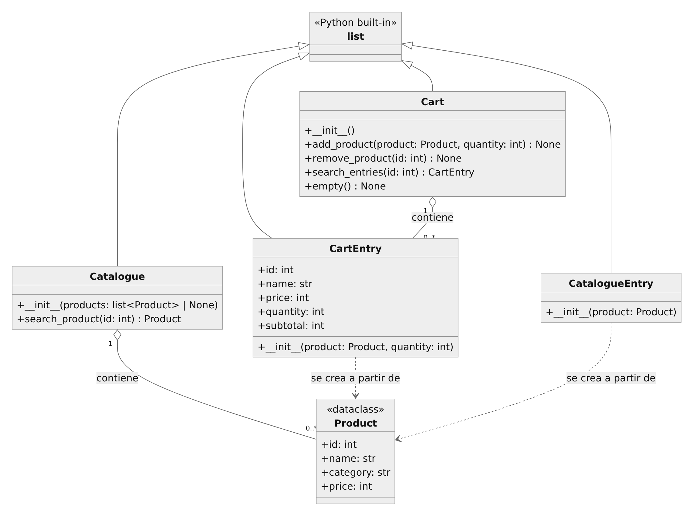

| Clase | Atributos | Métodos |
|---|---|---|
| **Product** *(dataclass)* | `id: int`<br>`name: str`<br>`category: str`<br>`price: int` | — (constructor generado por `@dataclass`) |
| **CatalogueEntry** *(hereda de `list`)* | `[id, name, category, price]` | `__init__(product)` |
| **CartEntry** *(hereda de `list`)* | `id`, `name`, `price`, `quantity`, `subtotal` | `__init__(product, quantity)` |
| **Catalogue** *(hereda de `list`)* | elementos: `Product` | `search_product(id) → Product` |
| **Cart** *(hereda de `list`)* | elementos: `CartEntry` | `add_product(product, quantity)`<br>`remove_product(id)`<br>`search_entries(id) → CartEntry`<br>`empty()` |

**Herencia:** `Catalogue`, `Cart`, `CartEntry` y `CatalogueEntry` **heredan de `list`**. Así, el catálogo y el carrito *son* listas de Python y usan directamente `append`, `remove`, `index`, `clear` y la iteración.

**Versión web:** `classes.js` traduce las mismas clases. Como en JavaScript no se hereda de `Array`, `Catalogue` guarda sus productos en `products: Product[]` y `Cart` sus renglones en `entries: CartEntry[]`. Para la interfaz se agregaron `CartEntry.setQuantity()` y, en `Cart`, `contains()`, `addOrIncrease()`, `updateQuantity()`, `isEmpty()`, `getTotal()` y `getItemCount()`.

---

## 2.4 Fase 4. Codificación

### Tecnologías y archivos

| Versión | Archivos | Tecnologías |
|---|---|---|
| Consola | `version-cli/classes.py`, `main.py`, `user_input.py`, `pretty_print.py` | Python 3.14 + `rich` (tablas en la terminal) |
| Web | `version-web/classes.js`, `app.js`, `ui.js`, `index.html`, `styles.css` | HTML5, CSS3, JavaScript |

### Operaciones sobre listas

```python
class Cart(list):
    def add_product(self, product: Product, quantity: int):
        entry = CartEntry(product, quantity)
        self.append(entry)                  # inserción al final

    def remove_product(self, id: int):
        for entry in self:
            if entry.id == id:
                self.remove(entry)          # eliminación

    def search_entries(self, id: int) -> CartEntry:
        match = None
        for entry in self:                  # búsqueda secuencial
            if entry.id == id:
                match = entry
                break
        if match is None:
            raise KeyError(f"No hay ningún producto con el identificador {id}")
        return match

    def empty(self):
        self.clear()                        # vaciar la lista
```

### Fórmulas y asignaciones

```python
self.subtotal = product.price * quantity           # subtotal del renglón

for entry in cart:                                 # resumen al finalizar
    items += entry.quantity
    products += 1
    total += entry.subtotal
```

```python
cart[entry_index] = CartEntry(match, new_quantity)  # actualización en la misma posición
```

### Condicionales y validaciones

```python
if search_id in range(first_catalogue_number, last_catalogue_number + 1):
    break
else:
    print(f"\nEl ID del producto debe ser un entero positivo entre 1 y 5, intente de nuevo")

if quantity > 0:
    break
else:
    print("La cantidad del producto debe ser un entero positivo, intente de nuevo")
```

### Documentación del código

La explicación de cada funcionalidad está en [`CODIGO.md`](carrito-de-compras/CODIGO.md). Ahí se distingue el código del equipo (**[EQUIPO]**) del agregado para la interfaz web (**[IA]**). Desde la página web se abre con el botón **Ver código**. En `version-web/classes.js` cada clase y método tiene comentarios JSDoc.

### Instalación y uso

**Consola**

1. Instale las dependencias:

   ```shell
   pip install -r requirements.txt
   ```

2. Inicie el programa:

   ```shell
   python main.py
   ```

3. Elija una opción del menú (1–9) y siga las indicaciones.

**Web:** abra `version-web/index.html` en el navegador o entre a la página publicada del proyecto.

### Limitaciones

- En consola, agregar dos veces el mismo producto crea dos renglones (la web suma las cantidades en un solo renglón).
- La búsqueda y la eliminación se hacen por ID.

---

## 2.5 Fase 5. Pruebas

| Req. | Prueba | Resultado esperado | Resultado | Evidencia |
|---|---|---|---|---|
| R1, R2 | Opción 1 / abrir la página | 5 productos con ID, nombre, categoría y precio | ✅ | Fig. 2.1, 2.9 |
| R3 | Buscar ID 9 y luego ID 3 | Error para 9; Monitor $3,200 para 3 | ✅ | Fig. 2.2, 2.10, 2.11 |
| R4, R5 | Teclado ×2 + Audífonos ×1 | Subtotales 900 y 800; total 1,700 | ✅ | Fig. 2.3, 2.12 |
| R6 | Teclado → cantidad 0, luego 3 | Rechaza 0; subtotal 1,350 | ✅ | Fig. 2.4, 2.13, 2.14 |
| R7 | Eliminar Audífonos (ID 4) | Se quita del carrito | ✅ | Fig. 2.5, 2.15, 2.16 |
| R8 | Vaciar con confirmación | Carrito vacío, total 0 | ✅ | Fig. 2.6, 2.17, 2.18 |
| R9 | Teclado ×3 + Mouse ×1 → finalizar | 2 productos, 4 artículos, total 1,600 | ✅ | Fig. 2.7, 2.19 |
| R10 | Opción 12, luego 9 | Mensaje de error; el programa termina | ✅ | Fig. 2.8 |

### Versión de consola

**Figura 2.1.** Menú principal y catálogo precargado (R1, R2).

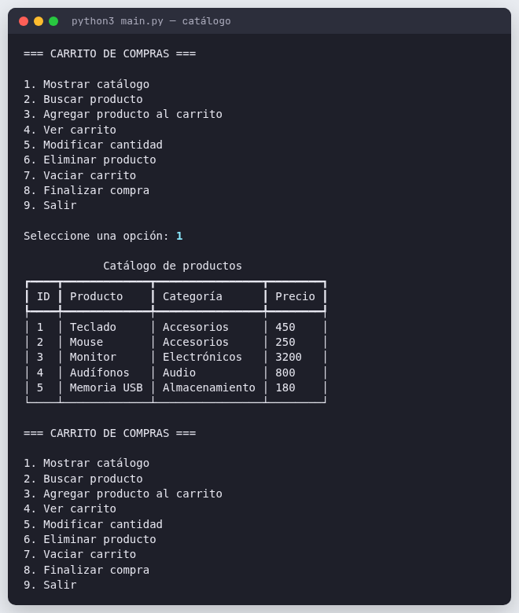

**Figura 2.2.** Búsqueda por ID con un ID inválido y uno válido (R3, R10).

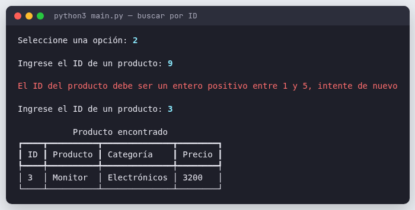

**Figura 2.3.** Agregar productos y ver el carrito con subtotales y total (R4, R5).

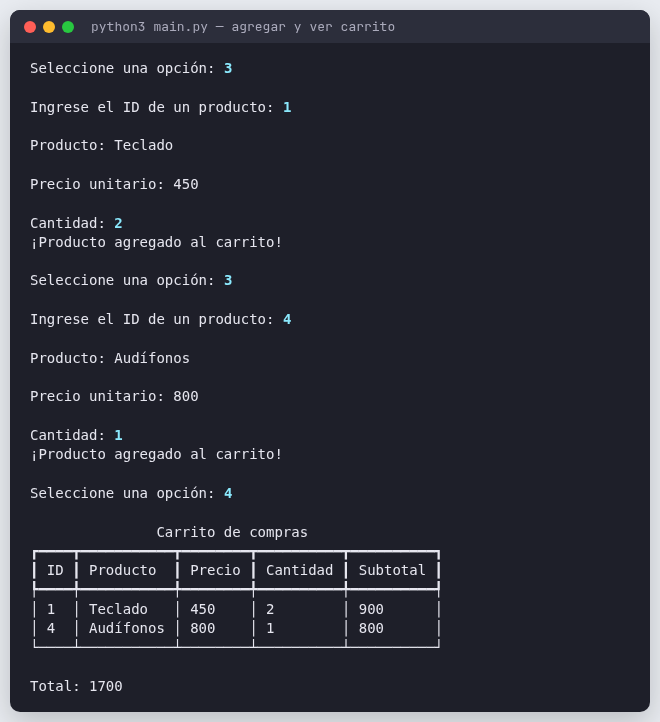

**Figura 2.4.** Modificar la cantidad: se rechaza 0 y se acepta 3; el subtotal se recalcula (R6).

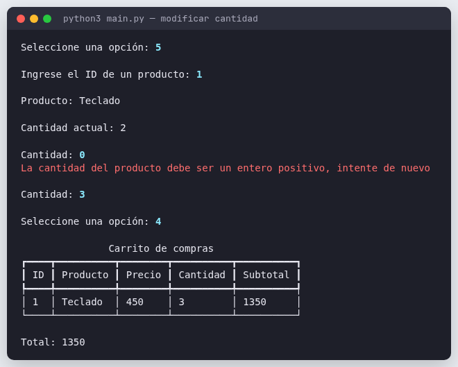

**Figura 2.5.** Eliminar un producto con confirmación (R7).

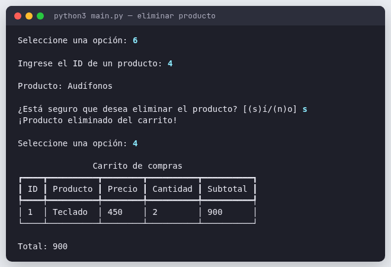

**Figura 2.6.** Vaciar el carrito con confirmación (R8).

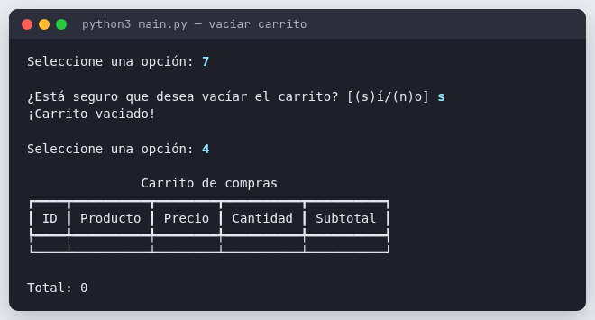

**Figura 2.7.** Finalizar la compra: productos, artículos y total (R9).

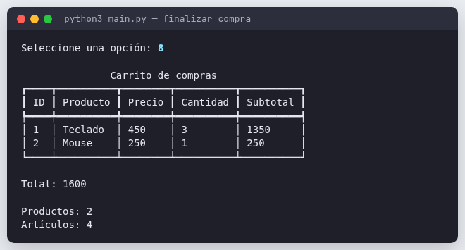

**Figura 2.8.** Opción inválida y salida del programa (R10).

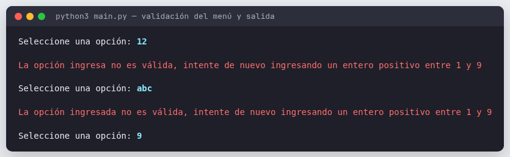

### Versión web

**Figura 2.9.** Catálogo precargado (R1, R2).


**Figura 2.10.** Búsqueda del ID 3: se resalta el Monitor (R3).


**Figura 2.11.** Búsqueda de un ID inexistente (R3, R10).


**Figura 2.12.** Teclado ×2, Audífonos ×1 y Teclado ×1 otra vez: la web suma la cantidad del Teclado (R4, R5).


**Figura 2.13.** Cantidad de Audífonos cambiada a 3; subtotal y total recalculados (R6).


**Figura 2.14.** Intento de poner la cantidad en 0: se rechaza (R6, R10).


**Figura 2.15.** Confirmación antes de eliminar (R7).

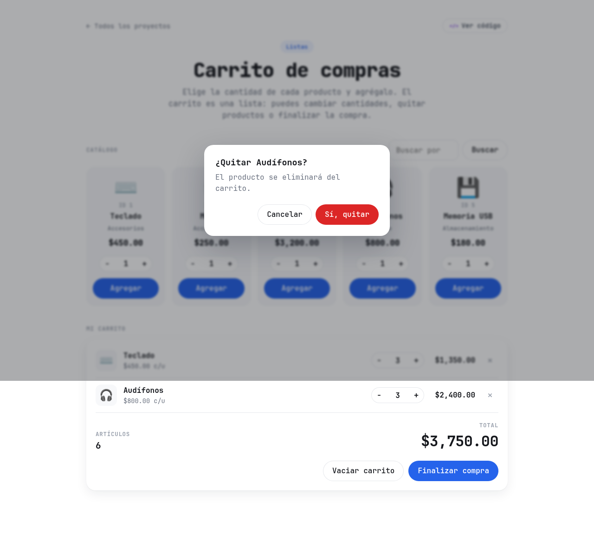

**Figura 2.16.** Carrito sin el producto eliminado (R7).

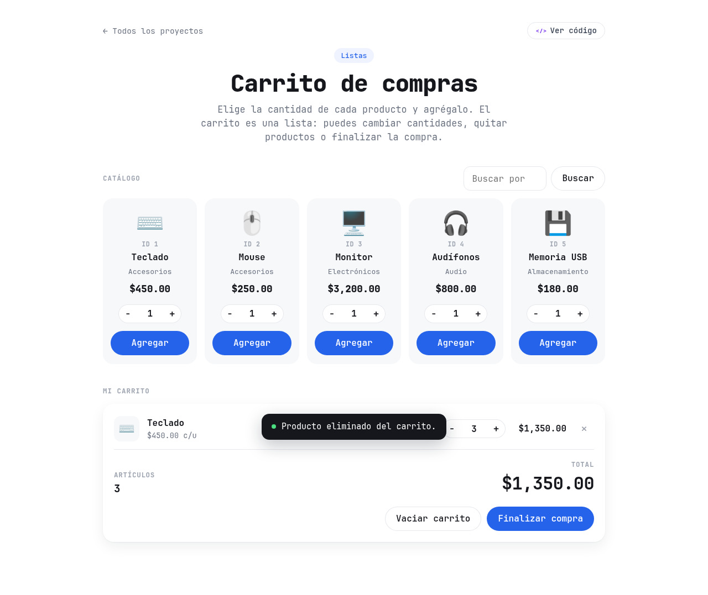

**Figura 2.17.** Confirmación para vaciar el carrito (R8).

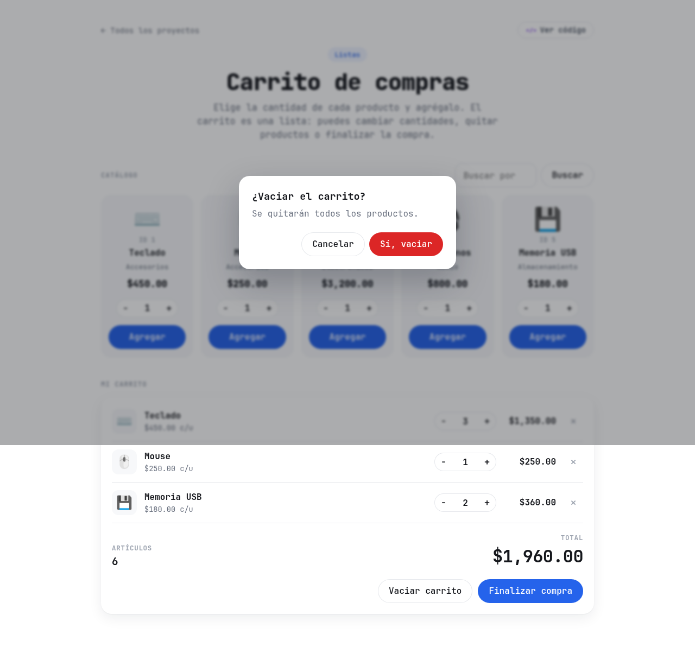

**Figura 2.18.** Carrito vacío (R8).


**Figura 2.19.** Ticket de compra: Monitor ×1 + Mouse ×2 → 2 productos, 3 artículos, $3,700.00 (R9).

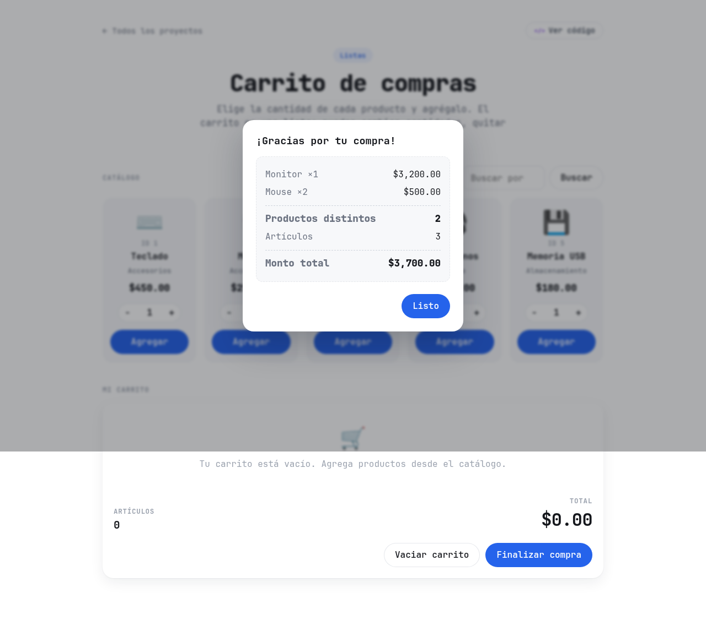

**Conclusión:** las operaciones de inserción, búsqueda, actualización y eliminación sobre la lista del carrito funcionan en las dos versiones. Los totales coinciden con el cálculo manual (por ejemplo, 3 × 450 + 1 × 250 = 1,600).

---

# Proyecto 3 — Navegador web

> **Estructura de datos:** Pilas (LIFO) · **Carpeta en el repositorio:** `buscador/`

## 3.1 Fase 1. Contextualización

### ¿Qué se debe hacer?

Simular el historial de un navegador web con **dos pilas**. El usuario puede visitar una dirección, **regresar** a la página anterior, **avanzar** a la página de la que regresó y **salir**. Las operaciones deben respetar el orden LIFO (el último en entrar es el primero en salir). Visitar una página nueva borra las páginas a las que se podía avanzar.

### ¿Qué se necesita?

- Una **pila de páginas visitadas** (historial). Su tope es la página actual y debajo quedan las anteriores.
- Una **pila de páginas siguientes**, donde se guardan las páginas de las que se regresó.
- Las operaciones `push` (apilar) y `pop` (desapilar) sobre ambas pilas.
- Validar que la dirección escrita sea una URL válida y no ejecutar `pop` sobre una pila vacía.
- Una interfaz que muestre la página actual y el contenido de ambas pilas.

### ¿Qué elementos se identifican?

| Elemento | Descripción |
|---|---|
| URL | Dirección que escribe el usuario (debe empezar con `https://`, `http://`, etc.). |
| Pila de visitadas (`visitados`) | Historial; el tope es la página actual. |
| Pila de siguientes (`retrocedidos`) | Páginas a las que se puede avanzar después de regresar. |
| Página actual | Tope de la pila de visitadas. |
| Acciones | Buscar (visitar), Retroceder, Avanzar y Exit. |

### Reglas de operación

| Acción | Efecto sobre las pilas |
|---|---|
| Visitar URL | `push(url)` en visitadas; la pila de siguientes **se vacía**. |
| Retroceder | `pop()` de visitadas y `push` de esa página en siguientes. |
| Avanzar | `pop()` de siguientes y `push` de esa página en visitadas. |
| Exit | Cierra la ventana del navegador. |

---

## 3.2 Fase 2. Definición de los requerimientos funcionales

| ID | Requerimiento |
|---|---|
| R1 | Visitar una página ingresando una URL |
| R2 | Retroceder a la página anterior |
| R3 | Avanzar a la página siguiente |
| R4 | Limpiar la pila de siguientes al visitar una página nueva |
| R5 | Mostrar la página actual y ambas pilas en todo momento |
| R6 | Evitar errores con URL inválida o pila vacía |
| R7 | Salir del programa |

| | |
|---|---|
| **Nombre** | R1 – Visitar una página ingresando una URL |
| **Descripción** | Valida la dirección con `URL.canParse`. Si es válida, la apila en la pila de visitadas, la convierte en la página actual y limpia la barra. Se activa con el botón **Buscar** o con la tecla Enter. |
| **Entrada** | URL. Ej.: `https://www.google.com` |
| **Salidas** | `Pagina actual: https://www.google.com` y la URL en la lista de páginas anteriores |

| | |
|---|---|
| **Nombre** | R2 – Retroceder a la página anterior |
| **Descripción** | Si la pila de visitadas no está vacía, desapila su tope y lo apila en la pila de siguientes. La nueva página actual es el nuevo tope. |
| **Entrada** | Botón **Retroceder** |
| **Salidas** | Página actual = página anterior; la página que se dejó aparece en "Páginas siguientes" |

| | |
|---|---|
| **Nombre** | R3 – Avanzar a la página siguiente |
| **Descripción** | Si la pila de siguientes no está vacía, desapila su tope y lo apila otra vez en la pila de visitadas. |
| **Entrada** | Botón **Avanzar** |
| **Salidas** | Página actual = página de la que se había regresado |

| | |
|---|---|
| **Nombre** | R4 – Limpiar la pila de siguientes al visitar una página nueva |
| **Descripción** | Visitar una URL nueva reinicia la pila de siguientes (`this.retrocedidos = []`), igual que en un navegador real. |
| **Entrada** | URL nueva después de haber retrocedido |
| **Salidas** | Lista "Páginas siguientes" vacía |

| | |
|---|---|
| **Nombre** | R5 – Mostrar la página actual y ambas pilas en todo momento |
| **Descripción** | Después de cada operación se dibujan la página actual (`dibujarActual`) y el contenido de las dos pilas (`dibujarVisitados`, `dibujarRetrocedidos`). |
| **Entrada** | — (después de cada acción) |
| **Salidas** | Texto "Pagina actual" y las listas "Páginas anteriores" y "Páginas siguientes" |

| | |
|---|---|
| **Nombre** | R6 – Evitar errores con URL inválida o pila vacía |
| **Descripción** | Una URL inválida no se apila. Retroceder o avanzar con la pila correspondiente vacía no hace nada, así que nunca se ejecuta `pop` sobre una pila vacía. |
| **Entrada** | `esto no es una url`, o Retroceder/Avanzar sin páginas |
| **Salidas** | Las pilas y la página actual no cambian |

| | |
|---|---|
| **Nombre** | R7 – Salir del programa |
| **Descripción** | El botón **Exit** llama a `window.close()` para cerrar la ventana. |
| **Entrada** | Botón **Exit** |
| **Salidas** | Se cierra la ventana (si el navegador lo permite) |

---

## 3.3 Fase 3. Diseño

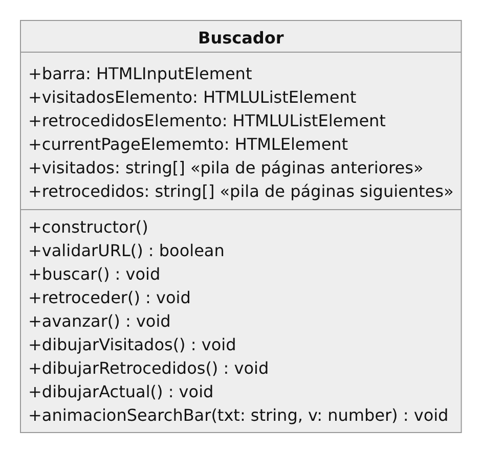

| Clase | Atributos | Métodos |
|---|---|---|
| **Buscador** | `visitados: string[]` — pila de páginas visitadas (tope = actual)<br>`retrocedidos: string[]` — pila de páginas siguientes<br>`barra: HTMLInputElement`<br>`visitadosElemento`, `retrocedidosElemento`, `currentPageElememto` (elementos de la página) | `validarURL() → boolean`<br>`buscar()`<br>`retroceder()`<br>`avanzar()`<br>`dibujarVisitados()`<br>`dibujarRetrocedidos()`<br>`dibujarActual()`<br>`animacionSearchBar(txt, v)` |

Las dos pilas se implementan con arreglos de JavaScript y **solo** se modifican por el final con `push` y `pop`, que es la disciplina LIFO. No hay herencia.

---

## 3.4 Fase 4. Codificación

### Tecnologías y archivos

| Archivo | Contenido |
|---|---|
| `index.html` | Barra de URL, botones y listas de las pilas |
| `buscador.js` | Clase `Buscador` y eventos (escrito por el equipo) |
| `styles.css` | Estilos de la interfaz |

Tecnologías: HTML5, CSS3 y JavaScript, sin librerías externas.

### Operaciones de pila

```js
buscar() {
  if (this.validarURL()) {                 // condicional: solo URLs válidas
    this.visitados.push(this.barra.value); // push en la pila de visitadas
    this.barra.value = "";
    this.retrocedidos = [];                // R4: se vacía la pila de siguientes
    this.dibujarVisitados();
    this.dibujarRetrocedidos();
    this.dibujarActual();
  }
}

retroceder() {
  if (this.visitados.length !== 0) {                     // evita pop en pila vacía
    this.retrocedidos.push(this.visitados.pop());        // pop de una pila, push en la otra
    /* … se vuelve a dibujar … */
  }
}

avanzar() {
  if (this.retrocedidos.length !== 0) {
    this.visitados.push(this.retrocedidos.pop());
    /* … */
  }
}
```

### Página actual (asignación desde el tope)

```js
dibujarActual() {
  const actual = this.visitados[this.visitados.length - 1]; // peek: tope de la pila
  this.currentPageElememto.textContent = actual ? `Pagina actual: ${actual}` : "Pagina actual: ";
}
```

### Documentación del código

La explicación de cada fragmento está en [`CODIGO.md`](buscador/CODIGO.md). También se puede abrir con el botón **Ver código** de la página.

### Uso

1. Abra `index.html` en el navegador o entre a la página publicada del proyecto.
2. Escriba una URL que empiece con `https://` y presione **Buscar** o Enter.
3. Use **Retroceder** y **Avanzar** para moverse por el historial.

### Limitaciones

- Una URL inválida o una pila vacía se ignoran sin mostrar mensaje.
- `window.close()` solo cierra ventanas que se abrieron desde un script; en una pestaña normal el navegador puede bloquearlo.

---

## 3.5 Fase 5. Pruebas

Secuencia de prueba: visitar `google.com` → `github.com` → `es.wikipedia.org`, retroceder dos veces, avanzar una vez, visitar `anahuac.mx/mayab` y escribir una URL inválida.

| Req. | Prueba | Resultado esperado | Resultado | Evidencia |
|---|---|---|---|---|
| R1, R5 | Visitar 3 URLs | Actual: wikipedia; anteriores: google, github, wikipedia | ✅ | Fig. 3.2 |
| R2 | Retroceder ×2 | Actual: google; siguientes: wikipedia, github | ✅ | Fig. 3.3 |
| R3 | Avanzar ×1 | Actual: github; siguientes: wikipedia | ✅ | Fig. 3.4 |
| R4 | Visitar anahuac.mx/mayab | Siguientes vacía; actual: anahuac | ✅ | Fig. 3.5 |
| R6 | `esto no es una url` | Sin cambios en las pilas | ✅ | Fig. 3.6 |
| R7 | Botón Exit | Llama a `window.close()` | ✅ (ver limitación) | — |

**Figura 3.1.** Estado inicial: ambas pilas vacías.

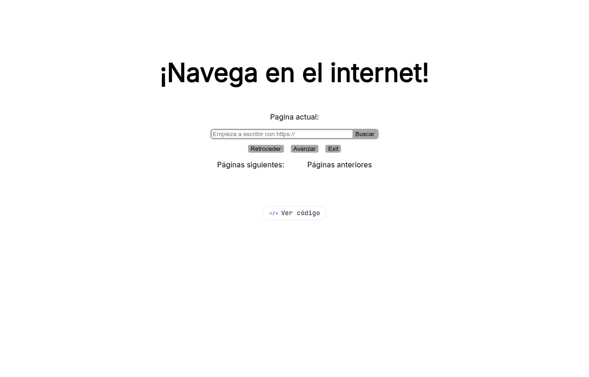

**Figura 3.2.** Después de visitar tres páginas, la actual es el tope de la pila de visitadas (R1, R5).

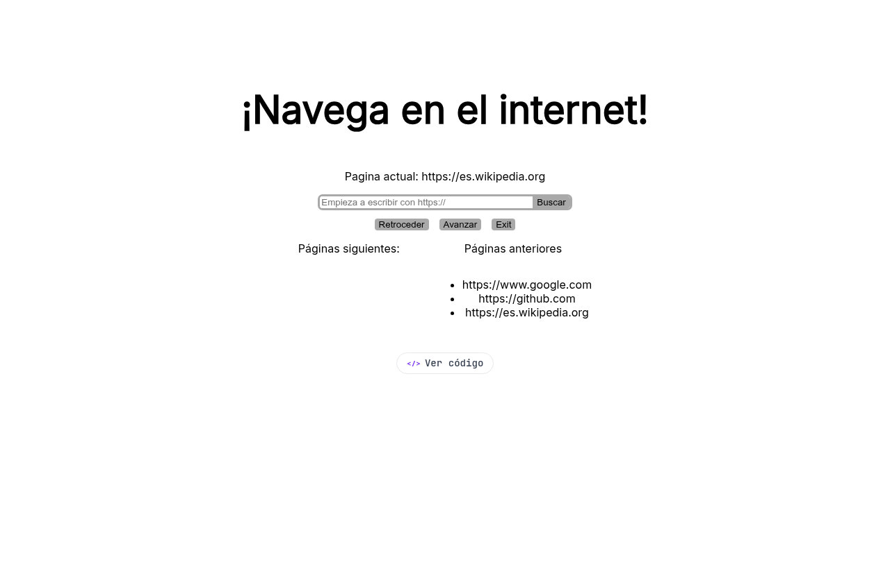

**Figura 3.3.** Después de retroceder dos veces, las páginas pasan a la pila de siguientes (R2).

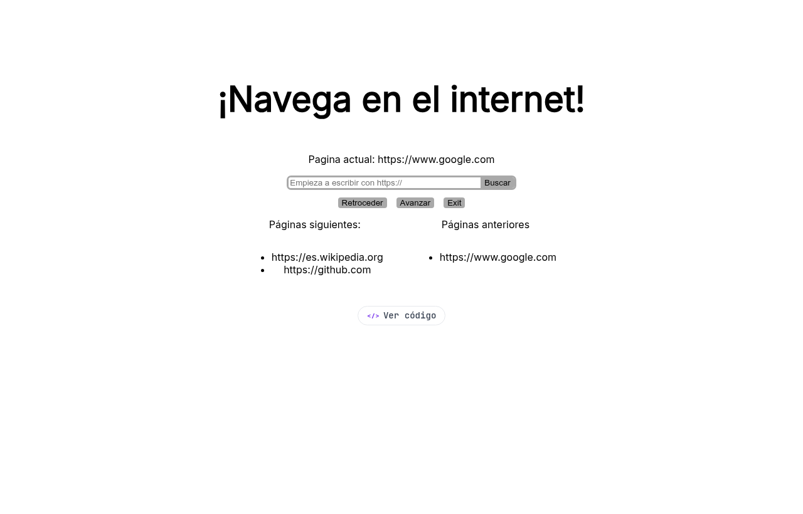

**Figura 3.4.** Al avanzar, `github.com` vuelve a la pila de visitadas (R3).

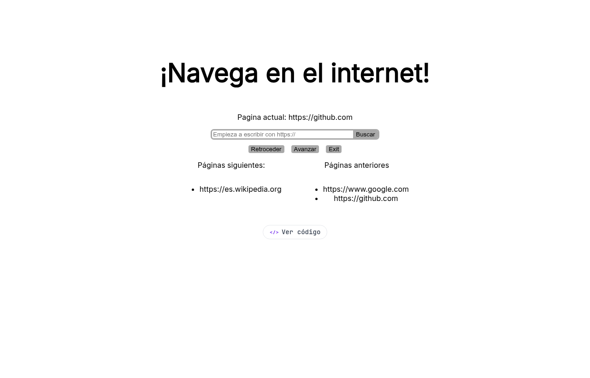

**Figura 3.5.** Al visitar una página nueva se vacía la pila de siguientes (R4).


**Figura 3.6.** Una URL inválida no modifica las pilas (R6).

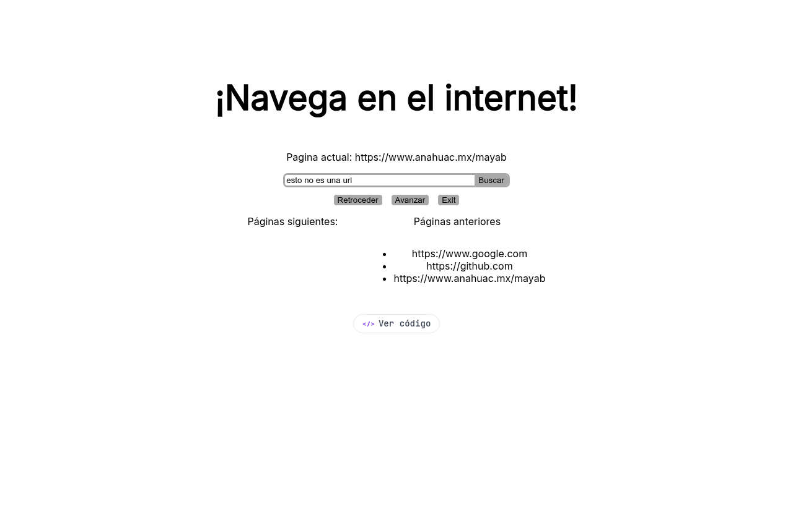

**Conclusión:** las dos pilas respetan el orden LIFO. Retroceder y avanzar mueven la página del tope de una pila a la otra, y visitar una página nueva vacía la pila de siguientes.

---

# Proyecto 4 — Cola de impresión

> **Estructura de datos:** Colas (FIFO) · **Carpeta en el repositorio:** `cola-impresion/`

## 4.1 Fase 1. Contextualización

### ¿Qué se debe hacer?

Implementar la **cola de impresión** de una impresora con la estructura de datos **cola** (FIFO: el primero en entrar es el primero en salir). Los trabajos nuevos se **encolan al final** y, al imprimir, se **desencola el del frente**, es decir, el más antiguo.

Para hacerlo, el equipo programó una aplicación *fullstack*:

- **Backend (API con FastAPI, Python):** guarda la cola de forma persistente y expone las operaciones de la cola como *endpoints*.
- **Frontend (React + Vite, JavaScript):** permite subir archivos para encolarlos, muestra la cola en orden y tiene el botón **Imprimir** sobre el trabajo del frente.

### ¿Qué se necesita?

- Una estructura cola con las operaciones **encolar** (agregar al final), **desencolar** (quitar del frente) y **consultar** (ver la cola completa).
- Persistencia: la cola se guarda en `queue.json` y los archivos en la carpeta `files/` del servidor. Así, cualquier computadora que abra la aplicación ve la misma cola.
- Una interfaz para subir archivos (arrastrar y soltar o botón **Buscar**) e imprimir.
- Manejo del caso de cola vacía.

### ¿Qué elementos se identifican?

| Elemento | Descripción |
|---|---|
| Trabajo de impresión | Archivo subido por el usuario (se identifica por su nombre). |
| Cola | Lista ordenada de nombres; el índice 0 es el **frente**. |
| Frente | Siguiente trabajo que se imprimirá. |
| Final | Posición donde entra cada trabajo nuevo. |
| `queue.json` | Archivo donde se guarda la cola. |
| `files/` | Carpeta donde se guardan los archivos encolados. |
| Endpoints | `POST /uploadfile` (encolar), `POST /getfiles` (consultar), `POST /printfile` (desencolar). |

---

## 4.2 Fase 2. Definición de los requerimientos funcionales

| ID | Requerimiento |
|---|---|
| R1 | Agregar trabajos a la cola (encolar al final) |
| R2 | Imprimir el trabajo del frente (desencolar) |
| R3 | Mostrar la cola en orden de atención |
| R4 | Manejar la cola vacía |

| | |
|---|---|
| **Nombre** | R1 – Agregar trabajos a la cola |
| **Descripción** | El usuario sube uno o varios archivos (arrastrándolos o con el botón **Buscar**). La API guarda cada archivo en `files/` y **agrega su nombre al final** de la lista en `queue.json`. Responde con la posición que ocupa. |
| **Entrada** | Uno o más archivos. Ej.: `tarea-estructuras.pdf` |
| **Salidas** | `{"status":"saved","name":"tarea-estructuras.pdf","position":1}` · en pantalla: tarjeta al final de la cola y el aviso "Encolaste …" |

| | |
|---|---|
| **Nombre** | R2 – Imprimir el trabajo del frente |
| **Descripción** | Al presionar **Imprimir**, la API saca el **primer** elemento de la cola (`pop(0)`), borra su archivo de `files/` y guarda la cola actualizada. Los demás trabajos avanzan una posición. |
| **Entrada** | Botón **Imprimir** (solo aparece sobre el trabajo del frente) |
| **Salidas** | `{"status":"printed","name":"tarea-estructuras.pdf","remaining":3}` · en pantalla: "Imprimiste tarea-estructuras.pdf" |

| | |
|---|---|
| **Nombre** | R3 – Mostrar la cola en orden de atención |
| **Descripción** | La interfaz consulta `POST /getfiles` y dibuja los trabajos de izquierda (frente) a derecha (final), con su posición y su tipo de archivo. Debajo muestra cuántos trabajos hay en espera. |
| **Entrada** | — (al cargar la página y después de cada operación) |
| **Salidas** | `["tarea-estructuras.pdf","reporte-practica.docx", …]` · tarjetas "Posición 1, 2, 3…" |

| | |
|---|---|
| **Nombre** | R4 – Manejar la cola vacía |
| **Descripción** | Si no hay trabajos, la interfaz muestra "La cola está vacía" y no muestra el botón **Imprimir**. Si se llama a `/printfile` con la cola vacía, la API responde con error **409** en lugar de fallar. |
| **Entrada** | Imprimir cuando no hay trabajos |
| **Salidas** | `{"detail":"La cola esta vacia"}` (HTTP 409) · en pantalla: "La cola está vacía. Sube un archivo para encolarlo." |

---

## 4.3 Fase 3. Diseño

En lugar de una clase `Queue`, el equipo implementó la cola como una **API** cuyos *endpoints* equivalen a los métodos de una cola. El estado (la lista) vive en `queue.json`, así la cola se conserva aunque se reinicie el servidor y se comparte entre todos los clientes.

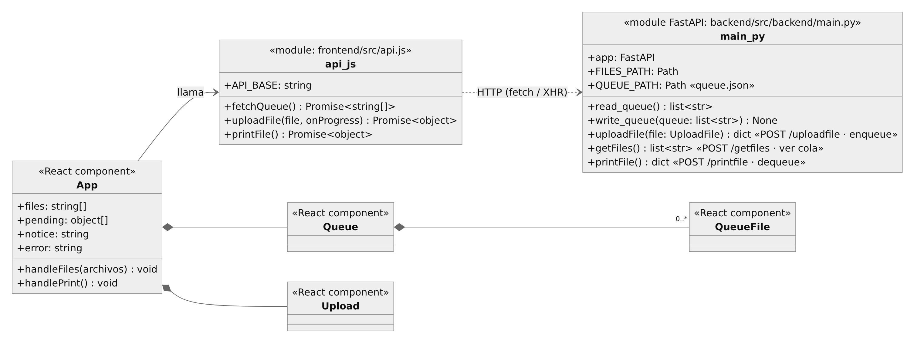

| Módulo / componente | Atributos | Métodos / funciones |
|---|---|---|
| **main.py** (API FastAPI) | `app: FastAPI`<br>`FILES_PATH: Path`<br>`QUEUE_PATH: Path` (`queue.json`) | `read_queue() → list[str]`<br>`write_queue(queue)`<br>`uploadFile(file) → dict` — **encolar**<br>`getFiles() → list[str]` — **consultar**<br>`printFile() → dict` — **desencolar** |
| **api.js** (cliente) | `API_BASE` | `fetchQueue()`<br>`uploadFile(file, onProgress)`<br>`printFile()` |
| **App** (React) | estado: `files`, `pending`, `notice`, `error`, `printing` | `handleFiles(archivos)`<br>`handlePrint()`<br>`refresh()` |
| **Queue**, **QueueFile**, **Upload** (React) | *props* recibidas de `App` | Dibujan la cola, cada tarjeta y la zona de carga |

| Operación de cola | Endpoint | Implementación |
|---|---|---|
| `enqueue(x)` | `POST /uploadfile` | `queue.append(file_name)` |
| `dequeue()` | `POST /printfile` | `queue.pop(0)` |
| `peek()` / recorrer | `POST /getfiles` | `return read_queue()` |
| `isEmpty()` | (dentro de `/printfile`) | `if not queue: raise HTTPException(409)` |

---

## 4.4 Fase 4. Codificación

### Tecnologías y archivos

| Parte | Archivos | Tecnologías |
|---|---|---|
| Backend | `backend/src/backend/main.py`, `queue.json`, `files/` | Python 3.14, FastAPI, Uvicorn, gestor `uv` |
| Frontend | `frontend/src/App.jsx`, `api.js`, `components/Queue.jsx`, `QueueFile.jsx`, `Upload.jsx` | React, Vite, JavaScript, CSS |

### Encolar (al final)

```python
@app.post("/uploadfile")
def uploadFile(file: UploadFile = File(...)):
    """Encola un archivo: lo guarda en disco y lo agrega al final."""
    file_name = os.path.basename(file.filename)
    with open(FILES_PATH / file_name, "wb") as buffer:
        shutil.copyfileobj(file.file, buffer)

    queue = read_queue()
    queue.append(file_name)          # enqueue
    write_queue(queue)
    return {"status": "saved", "name": file_name, "position": len(queue)}
```

### Desencolar (del frente) y cola vacía

```python
@app.post("/printfile")
def printFile():
    """Imprime: saca el archivo del frente de la cola y lo borra del disco."""
    queue = read_queue()
    if not queue:                                        # condicional: cola vacía
        raise HTTPException(status_code=409, detail="La cola esta vacia")

    file_name = queue.pop(0)                             # dequeue (FIFO)
    (FILES_PATH / file_name).unlink(True)
    write_queue(queue)
    return {"status": "printed", "name": file_name, "remaining": len(queue)}
```

### Cliente (frontend)

```js
/** Imprime: saca el archivo del frente de la cola. */
export async function printFile() {
  const response = await fetch(`${API_BASE}/printfile`, { method: "POST" });
  const texto = await response.text();
  if (!response.ok) throw new Error(leerDetalle(texto, "No se pudo imprimir el archivo."));
  return JSON.parse(texto);
}
```

### Documentación del código

Cada función del backend tiene un *docstring* que dice qué operación de la cola realiza. En `api.js` cada función tiene un comentario JSDoc.

### Instalación y uso

1. **Backend** (en `backend/`):

   ```shell
   uv sync
   uv run uvicorn --app-dir src backend.main:app --port 8000
   ```

2. **Frontend** (en `frontend/`):

   ```shell
   npm install
   npm run dev
   ```

3. Abra `http://localhost:5173`. Para apuntar a otra dirección de la API, copie `.env.example` como `.env` y cambie `VITE_API_URL`.

### Limitaciones

- No puede publicarse en GitHub Pages porque necesita el servidor FastAPI en ejecución.
- Los archivos se identifican por su nombre; si se sube dos veces un archivo con el mismo nombre, la segunda copia reemplaza a la primera en disco.

---

## 4.5 Fase 5. Pruebas

| Req. | Prueba | Resultado esperado | Resultado | Evidencia |
|---|---|---|---|---|
| R4 | Abrir la aplicación sin trabajos | "La cola está vacía…" | ✅ | Fig. 4.1 |
| R1 | Subir `tarea-estructuras.pdf` | Queda en la posición 1 | ✅ | Fig. 4.2 |
| R1, R3 | Subir 3 archivos más | Quedan en las posiciones 2, 3 y 4, en el orden en que se subieron | ✅ | Fig. 4.3 |
| R2 | Imprimir | Sale `tarea-estructuras.pdf` (el más antiguo); los demás avanzan | ✅ | Fig. 4.4, 4.5 |
| R2, R4 | Imprimir hasta vaciar | Cola vacía; ya no aparece **Imprimir** | ✅ | Fig. 4.6 |
| R1–R4 | Probar la API con `curl` | FIFO correcto y 409 con la cola vacía | ✅ | Fig. 4.7 |

**Figura 4.1.** Cola vacía al iniciar (R4).


**Figura 4.2.** Primer trabajo encolado: queda al frente con el botón **Imprimir** (R1).


**Figura 4.3.** Cuatro trabajos en orden de llegada; el frente está a la izquierda (R1, R3).

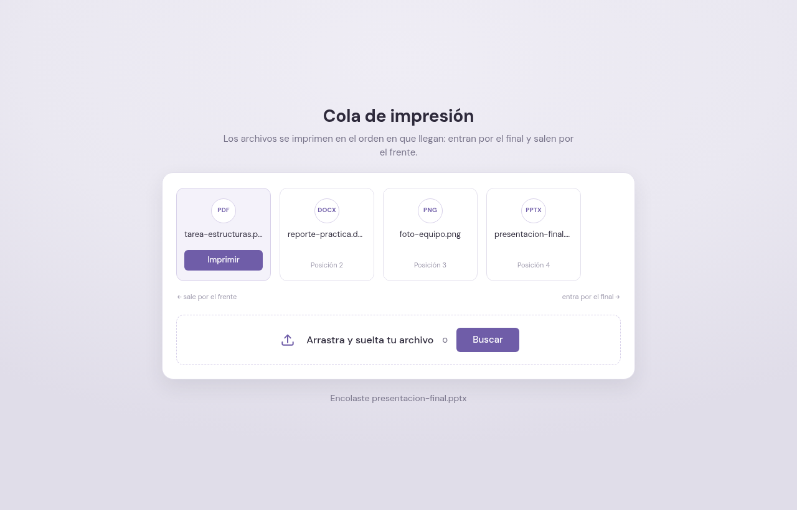

**Figura 4.4.** Al imprimir, el trabajo del frente sale de la cola (animación de salida) (R2).

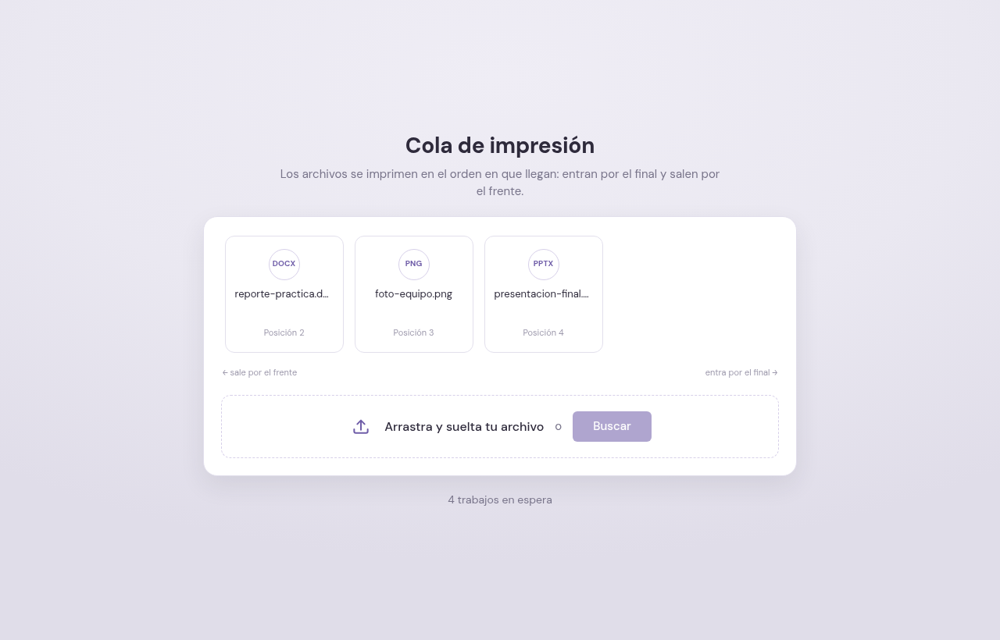

**Figura 4.5.** Después de imprimir: "Imprimiste tarea-estructuras.pdf" y los demás avanzan una posición (R2).

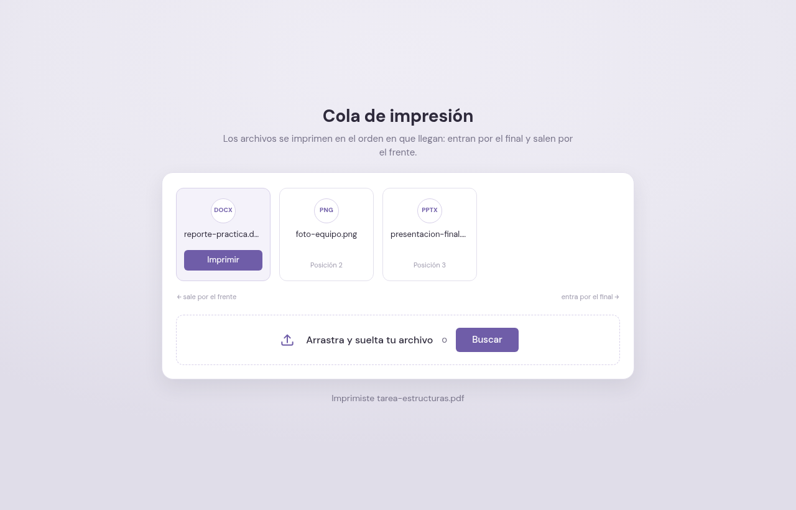

**Figura 4.6.** Después de imprimir todos los trabajos, la cola queda vacía (R2, R4).


**Figura 4.7.** Prueba directa de la API: encolar dos archivos, consultar, desencolar en orden FIFO y error 409 con la cola vacía (R1–R4).

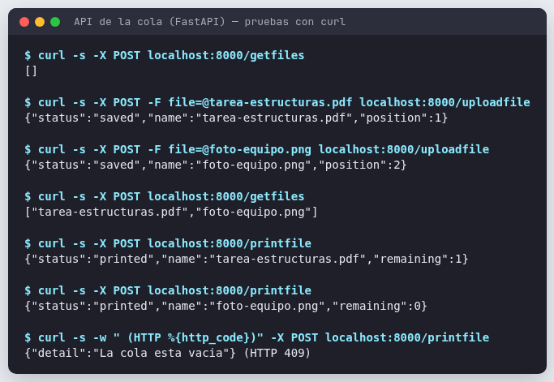

**Conclusión:** los trabajos se atienden en el mismo orden en que llegan (FIFO). La API rechaza imprimir con la cola vacía sin detenerse.

---

# Proyecto 5 — Sistema de archivos

> **Estructura de datos:** Árbol binario de búsqueda · **Carpeta en el repositorio:** `sistema-de-archivos/`

## 5.1 Fase 1. Contextualización

### ¿Qué se debe hacer?

Simular un sistema de archivos con un **árbol binario de búsqueda** en el que cada nodo es un **archivo** o un **directorio**, ordenado alfabéticamente por nombre. El programa empieza con el directorio raíz `Documentos`. Permite crear directorios, insertar archivos, buscar y eliminar elementos y recorrer el árbol en inorden, preorden y postorden. Hay dos versiones:

- **Consola (Python):** menú de 8 opciones con tablas en la terminal (librería `rich`).
- **Web (HTML + JavaScript):** dibuja el árbol, anima la búsqueda y los recorridos y muestra la ficha de cada elemento. Usa las mismas clases traducidas a JavaScript.

### ¿Qué se necesita?

- Una clase **Nodo** con nombre, extensión, tamaño en bytes, tipo (archivo o directorio) e hijos izquierdo y derecho.
- Una clase **Árbol** con la raíz y las operaciones de insertar, buscar, eliminar y los tres recorridos.
- Reglas del sistema de archivos:
  - La raíz es un directorio y **no puede eliminarse**.
  - Un **archivo siempre es hoja**: no puede contener otros elementos.
  - **No hay nombres duplicados.**
  - Un archivo **debe** tener extensión (máximo 3 caracteres) y un tamaño ≥ 0.

### ¿Qué elementos se identifican?

| Elemento | Descripción |
|---|---|
| Nodo | Archivo o directorio: `name`, `extension`, `size`, `file_type`, `left`, `right`. |
| Raíz | Directorio `Documentos`, creado al iniciar. |
| Clave de orden | El nombre, comparado alfabéticamente (menor → izquierda, mayor → derecha). |
| Directorio | Nodo que puede tener hijos (tamaño 0, sin extensión). |
| Archivo | Nodo hoja con extensión y tamaño. |
| Recorridos | Inorden (izq-raíz-der), preorden (raíz-izq-der), postorden (izq-der-raíz). |
| Casos de eliminación | Hoja, un hijo o dos hijos (sucesor inorden). |

---

## 5.2 Fase 2. Definición de los requerimientos funcionales

| ID | Requerimiento |
|---|---|
| R1 | Crear directorio |
| R2 | Insertar archivo |
| R3 | Buscar elemento por nombre |
| R4 | Eliminar archivo o directorio |
| R5 | Recorrido inorden |
| R6 | Recorrido preorden |
| R7 | Recorrido postorden |
| R8 | Mostrar la información de un elemento |
| R9 | Validar las reglas de inserción |
| R10 | Salir |

| | |
|---|---|
| **Nombre** | R1 – Crear directorio |
| **Descripción** | Crea un nodo de tipo directorio y lo inserta en el ABB: desciende desde la raíz comparando nombres hasta encontrar un lugar vacío. |
| **Entrada** | Nombre. Ej.: `Fotos` |
| **Salidas** | `Directorio 'Fotos' insertado correctamente en el árbol` y el árbol actualizado |

| | |
|---|---|
| **Nombre** | R2 – Insertar archivo |
| **Descripción** | Crea un nodo de tipo archivo con extensión y tamaño, y lo inserta igual que un directorio. Al ser archivo, quedará siempre como hoja. |
| **Entrada** | Nombre, extensión y tamaño. Ej.: `Tarea`, `txt`, `1200` |
| **Salidas** | `Archivo 'Tarea' (1200 bytes) insertado correctamente en el árbol` |

| | |
|---|---|
| **Nombre** | R3 – Buscar elemento por nombre |
| **Descripción** | Búsqueda binaria: desde la raíz va a la izquierda o a la derecha según la comparación alfabética, hasta encontrar el nombre o llegar a un hijo vacío. |
| **Entrada** | Nombre. Ej.: `Tarea` / `Nada` |
| **Salidas** | Tabla Nombre, Extensión, Tamaño, Tipo, o `Could not find an element with the name Nada` / "El elemento no existe en el sistema de archivos." |

| | |
|---|---|
| **Nombre** | R4 – Eliminar archivo o directorio |
| **Descripción** | Busca el elemento, muestra su información y pide confirmación. Aplica los tres casos del ABB: **hoja** (se desconecta), **un hijo** (el hijo ocupa su lugar) y **dos hijos** (se reemplaza por su sucesor inorden, el mínimo del subárbol derecho). La raíz está protegida. |
| **Entrada** | Nombre y confirmación `s`/`n`. Ej.: `Backup`, `s` |
| **Salidas** | Árbol actualizado, o `Cannot delete the root directory` / "PROTEGIDO: No se puede eliminar el directorio raíz." |

| | |
|---|---|
| **Nombre** | R5 – Recorrido inorden |
| **Descripción** | Visita el subárbol izquierdo, después el nodo y después el subárbol derecho. Da los elementos en orden alfabético. |
| **Entrada** | Opción `5` / botón **Inorden** |
| **Salidas** | Tabla Nombre, Extensión, Tamaño, Tipo en orden inorden |

| | |
|---|---|
| **Nombre** | R6 – Recorrido preorden |
| **Descripción** | Visita el nodo, después el subárbol izquierdo y después el derecho. La raíz aparece primero. |
| **Entrada** | Opción `6` / botón **Preorden** |
| **Salidas** | Tabla en orden preorden |

| | |
|---|---|
| **Nombre** | R7 – Recorrido postorden |
| **Descripción** | Visita el subárbol izquierdo, después el derecho y al final el nodo. La raíz aparece al último. |
| **Entrada** | Opción `7` / botón **Postorden** |
| **Salidas** | Tabla en orden postorden |

| | |
|---|---|
| **Nombre** | R8 – Mostrar la información de un elemento |
| **Descripción** | Muestra la ficha del elemento encontrado o seleccionado: nombre, extensión, tamaño y tipo. En la web también muestra el camino desde la raíz. |
| **Entrada** | Nombre buscado o clic sobre un nodo (web) |
| **Salidas** | Ficha del elemento |

| | |
|---|---|
| **Nombre** | R9 – Validar las reglas de inserción |
| **Descripción** | Rechaza: nombres duplicados, insertar debajo de un archivo, nombre vacío, extensión vacía o de más de 3 caracteres, tamaño negativo y caracteres no ASCII. Muestra el error y vuelve a pedir los datos. |
| **Entrada** | `Fotos` (duplicado), `Zeta.pdf` (cae bajo un archivo), nombre vacío, `docx` |
| **Salidas** | `…there is already an element with such name`, `…a file cannot contain other elements`, `The file or directory cannot be the empty string`, `The file extension length cannot exceed 3…` |

| | |
|---|---|
| **Nombre** | R10 – Salir |
| **Descripción** | Termina el programa de consola. |
| **Entrada** | Opción `8` |
| **Salidas** | `Exiting...` |

---

## 5.3 Fase 3. Diseño

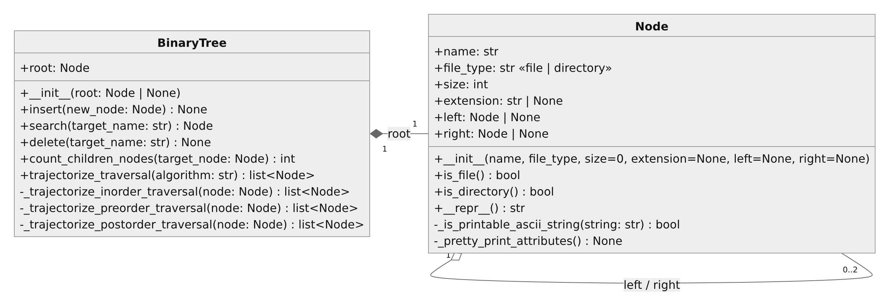

| Clase | Atributos | Métodos |
|---|---|---|
| **Node** | `name: str`<br>`file_type: str` (`file` \| `directory`)<br>`size: int`<br>`extension: str \| None`<br>`left: Node \| None`<br>`right: Node \| None` | `is_file() → bool`<br>`is_directory() → bool`<br>`_is_printable_ascii_string(string) → bool`<br>`_pretty_print_attributes()`<br>`__repr__() → str` |
| **BinaryTree** | `root: Node` | `insert(new_node)`<br>`search(target_name) → Node`<br>`delete(target_name)`<br>`count_children_nodes(target_node) → int`<br>`trajectorize_traversal(algorithm) → list[Node]`<br>`_trajectorize_inorder_traversal(node)`<br>`_trajectorize_preorder_traversal(node)`<br>`_trajectorize_postorder_traversal(node)` |

**Relaciones:** `BinaryTree` se compone de un `Node` raíz. Cada `Node` se relaciona consigo mismo con 0 a 2 hijos (`left`, `right`), que es la estructura recursiva del árbol. No hay herencia: archivo y directorio se distinguen con el atributo `file_type`.

**Versión web:** `classes.js` traduce las clases como `FileNode` y `BinaryTree`. Para la interfaz se agregaron `FileNode.fullName()` y, en `BinaryTree`, `searchPath(name)` (camino recorrido, para animarlo), `height()` y `size()`.

---

## 5.4 Fase 4. Codificación

### Tecnologías y archivos

| Versión | Archivos | Tecnologías |
|---|---|---|
| Consola | `version-cli/classes.py`, `main.py`, `constants.py` | Python 3.14 + `rich` |
| Web | `version-web/classes.js`, `app.js`, `ui.js`, `index.html`, `styles.css` | HTML5, CSS3, JavaScript, SVG |

### Inserción (condicionales del ABB)

```python
def insert(self, new_node: Node):
    current_node: Node = self.root
    previous_node: Node | None = None

    while current_node is not None:
        previous_node = current_node
        if current_node.name == new_node.name:                 # sin duplicados
            raise ValueError(f"Cannot insert element with the name {new_node.name!r}, ...")
        if new_node.name < current_node.name:
            current_node = current_node.left                    # menor → izquierda
        elif new_node.name > current_node.name:
            current_node = current_node.right                   # mayor → derecha

    if not previous_node.is_directory():                        # un archivo es hoja
        raise ValueError(f"Cannot insert element in node {previous_node.name!r}, a file cannot contain other elements")

    if new_node.name < previous_node.name:
        previous_node.left = new_node
    elif new_node.name > previous_node.name:
        previous_node.right = new_node
```

### Eliminación (tres casos)

```python
match self.count_children_nodes(target_node):
    case 2:   # sucesor inorden: mínimo del subárbol derecho
        current_node, previous_node = target_node.right, target_node
        while current_node.left is not None:
            previous_node, current_node = current_node, current_node.left
        target_node.name = current_node.name          # se copian los datos del sucesor
        ...
    case 1:   # el único hijo ocupa el lugar del nodo
        replacement = target_node.right if target_node.left is None else target_node.left
        ...
    case 0:   # hoja: se desconecta del padre
        ...
```

### Recorridos recursivos

```python
def _trajectorize_inorder_traversal(self, node: Node):
    trajectory = []
    if node is not None:
        trajectory.extend(self._trajectorize_inorder_traversal(node.left))
        trajectory.append(node)
        trajectory.extend(self._trajectorize_inorder_traversal(node.right))
    return trajectory
```

En preorden, `append(node)` va antes de las dos llamadas recursivas; en postorden, después.

### Documentación del código

La explicación de cada funcionalidad está en [`CODIGO.md`](sistema-de-archivos/CODIGO.md). Ahí se distingue el código del equipo (**[EQUIPO]**) del agregado para la interfaz web (**[IA]**). Se abre también con el botón **Ver código** de la página. En `version-web/classes.js` cada clase y método tiene comentarios JSDoc.

### Instalación y uso

**Consola**

1. Instale las dependencias:

   ```shell
   pip install -r requirements.txt
   ```

2. Inicie el programa:

   ```shell
   python main.py
   ```

3. Elija una opción del menú (1–8).

**Web:** abra `version-web/index.html` en el navegador o entre a la página publicada del proyecto.

### Limitaciones

- Los nombres se comparan carácter por carácter (orden ASCII): las mayúsculas van antes que las minúsculas y no se admiten acentos.
- Un directorio con dos hijos no se puede eliminar si su sucesor inorden es un archivo, porque el archivo quedaría con hijos.

---

## 5.5 Fase 5. Pruebas

Árbol de prueba: raíz `Documentos`; directorios `Fotos`, `Apuntes`, `Musica`, `Backup`; archivos `Tarea.txt` (1200 B) e `Indice.md` (80 B). Resultado: 7 nodos y altura 4.

| Req. | Prueba | Resultado esperado | Resultado | Evidencia |
|---|---|---|---|---|
| R1 | Crear Fotos, Apuntes, Musica | Apuntes a la izquierda de la raíz; Fotos a la derecha; Musica a la derecha de Fotos | ✅ | Fig. 5.2, 5.10 |
| R2 | Tarea.txt, Indice.md | Insertados como hojas bajo Musica | ✅ | Fig. 5.3, 5.11 |
| R9 | Fotos repetido, Zeta.pdf, nombre vacío, `docx`, sin extensión | Mensajes de error | ✅ | Fig. 5.2, 5.3, 5.12–5.14 |
| R3, R8 | Buscar Tarea / Indice y Nada | Ficha del elemento / "no existe" | ✅ | Fig. 5.4, 5.15, 5.16 |
| R5 | Inorden | Apuntes, Backup, Documentos, Fotos, Indice, Musica, Tarea | ✅ | Fig. 5.5, 5.17 |
| R6 | Preorden | Documentos, Apuntes, Backup, Fotos, Musica, Indice, Tarea | ✅ | Fig. 5.6, 5.18 |
| R7 | Postorden | Backup, Apuntes, Indice, Tarea, Musica, Fotos, Documentos | ✅ | Fig. 5.7, 5.19 |
| R4 | Eliminar Documentos; Backup | Raíz protegida; Backup eliminado | ✅ | Fig. 5.8, 5.20–5.22 |
| R10 | Opción 8 | `Exiting...` | ✅ | Fig. 5.8 |

### Versión de consola

**Figura 5.1.** Menú principal.

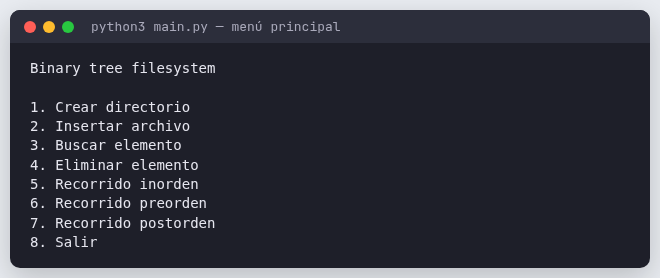

**Figura 5.2.** Crear directorios, incluido un nombre duplicado (R1, R9).

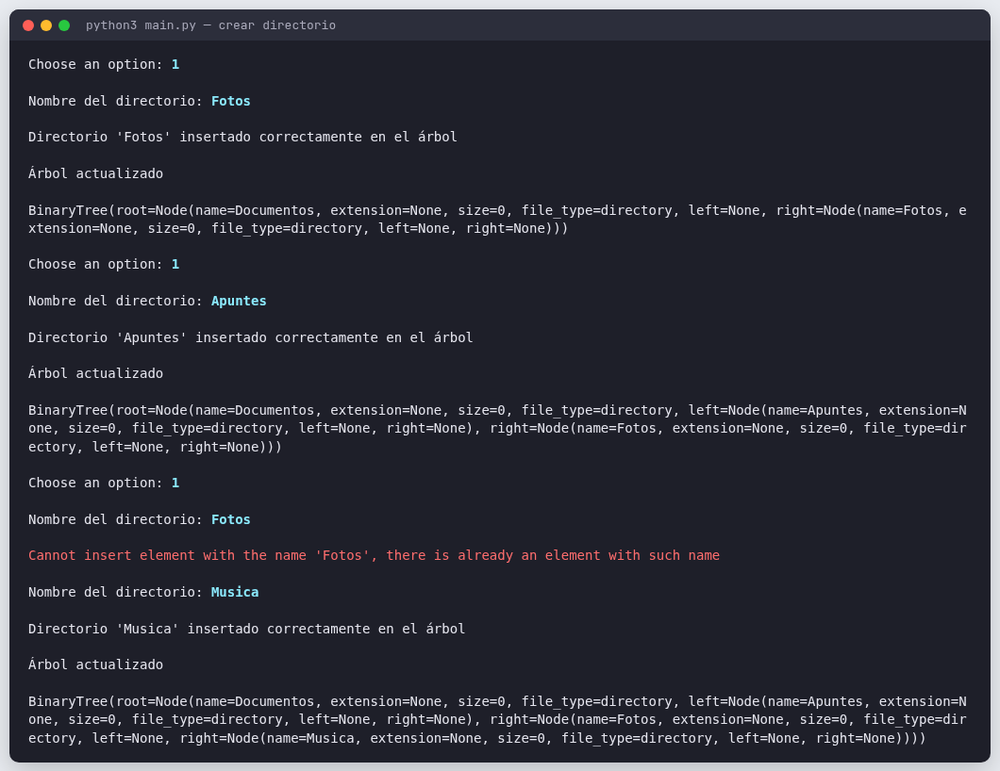

**Figura 5.3.** Insertar archivos: errores por caer debajo de un archivo, nombre vacío y extensión de 4 caracteres (R2, R9).

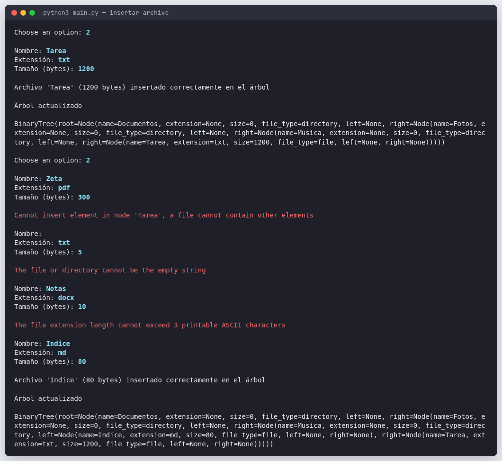

**Figura 5.4.** Buscar un nombre inexistente y uno existente (R3, R8).

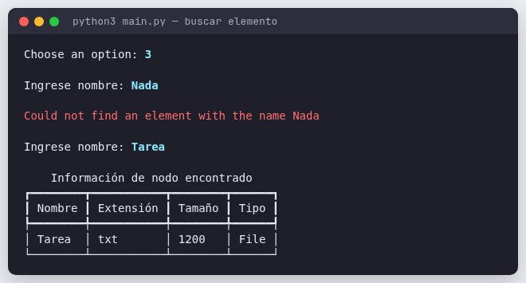

**Figura 5.5.** Recorrido inorden: orden alfabético (R5).

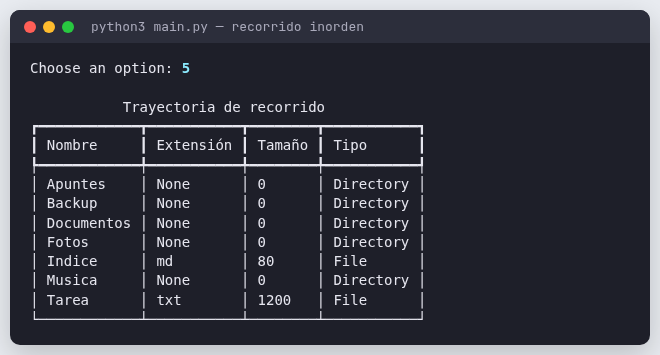

**Figura 5.6.** Recorrido preorden: la raíz primero (R6).

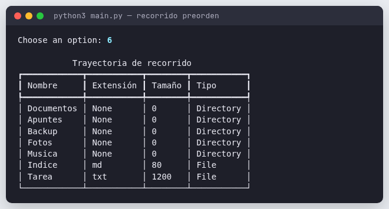

**Figura 5.7.** Recorrido postorden: la raíz al último (R7).

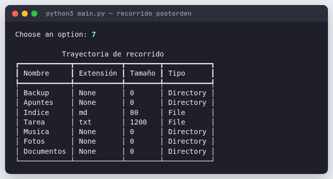

**Figura 5.8.** Eliminar: la raíz está protegida; al responder `n` con `Apuntes` no se elimina y se pide otro nombre; `Backup` se elimina con `s`. Después, la opción 8 termina el programa (R4, R10).

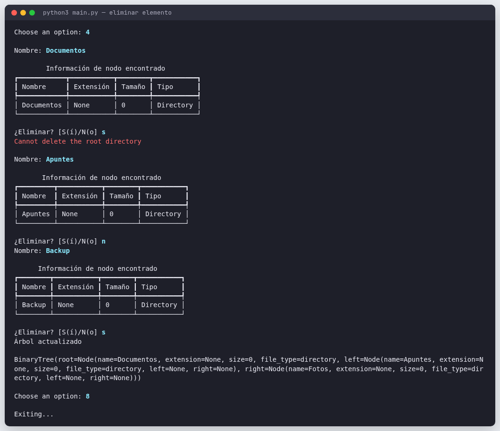

### Versión web

**Figura 5.9.** Estado inicial: solo el directorio raíz `Documentos`.

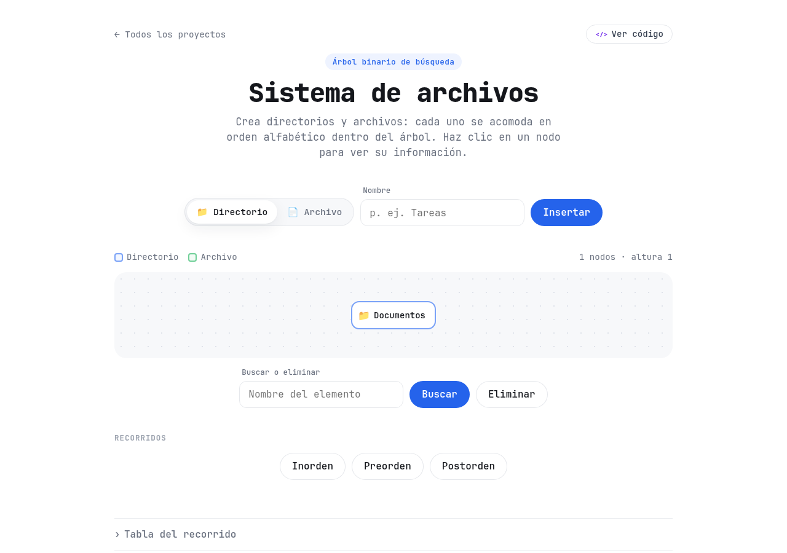

**Figura 5.10.** Directorios insertados (azul) en orden alfabético (R1).

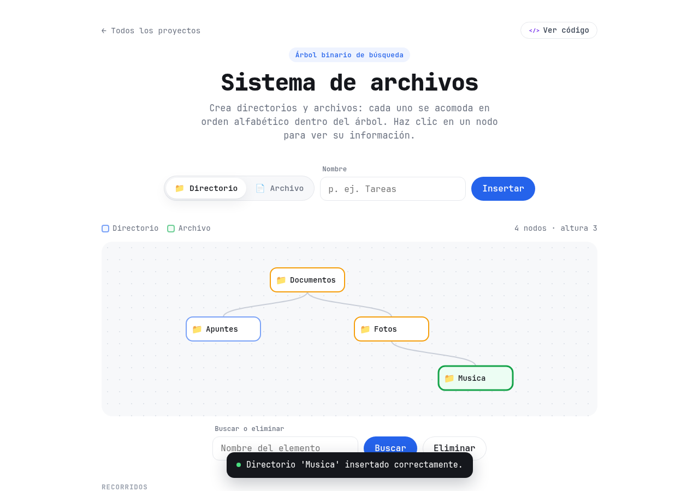

**Figura 5.11.** Archivo `Tarea.txt` insertado como hoja (verde) (R2).

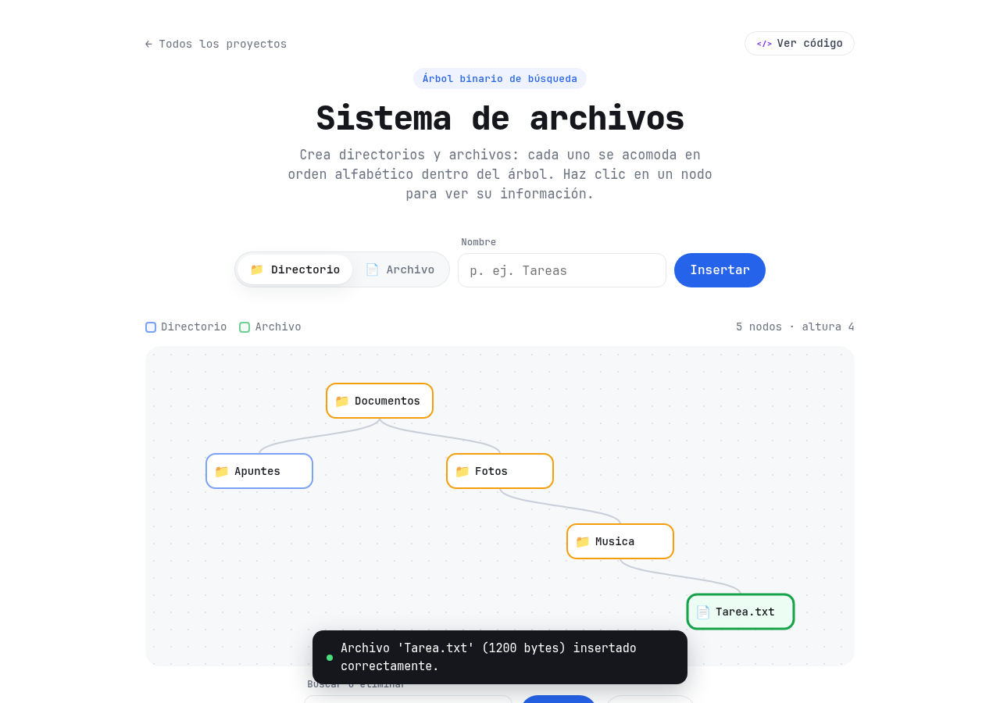

**Figura 5.12.** `Zeta.pdf` no se inserta porque caería debajo de un archivo (R9).

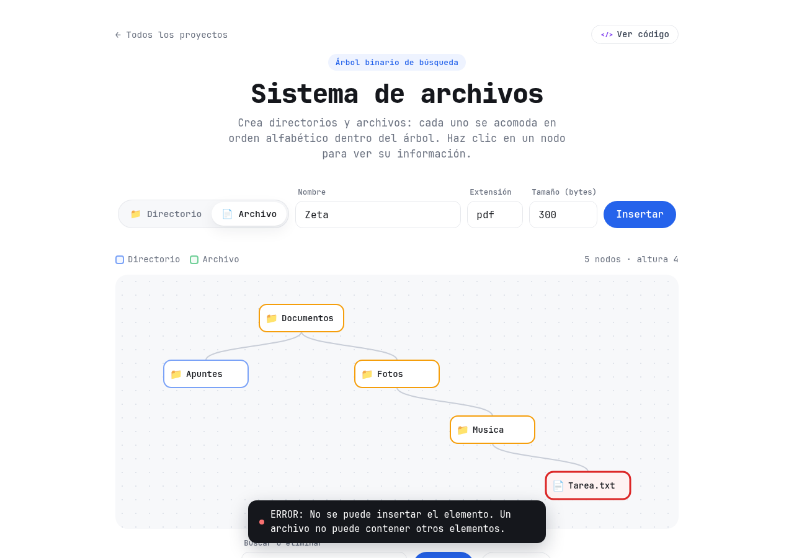

**Figura 5.13.** Nombre duplicado (R9).

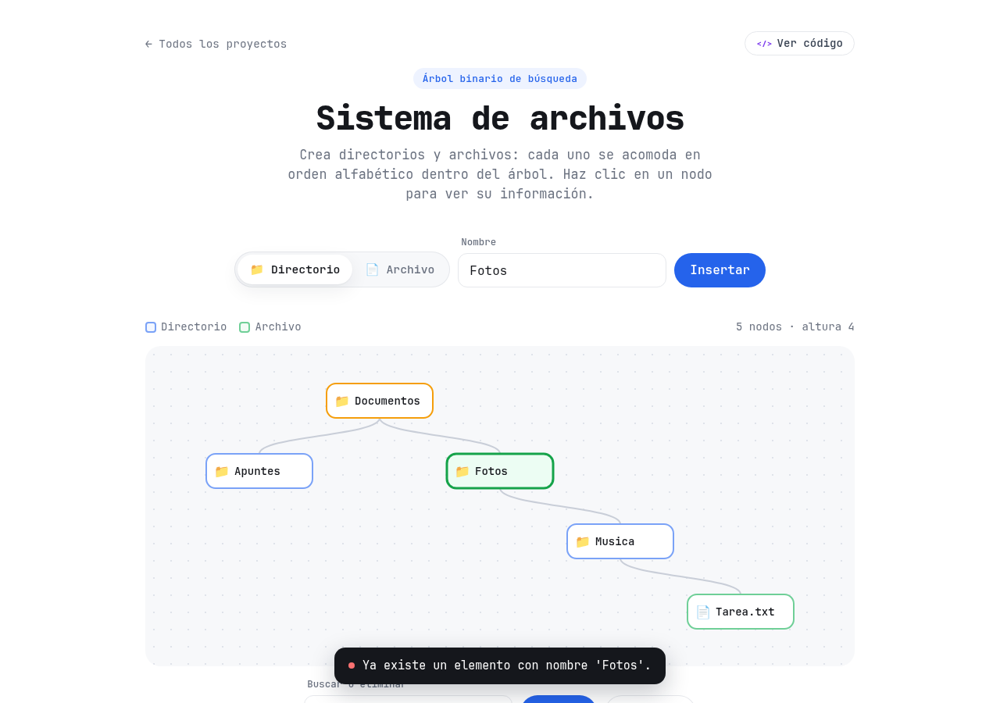

**Figura 5.14.** Archivo sin extensión (R9).

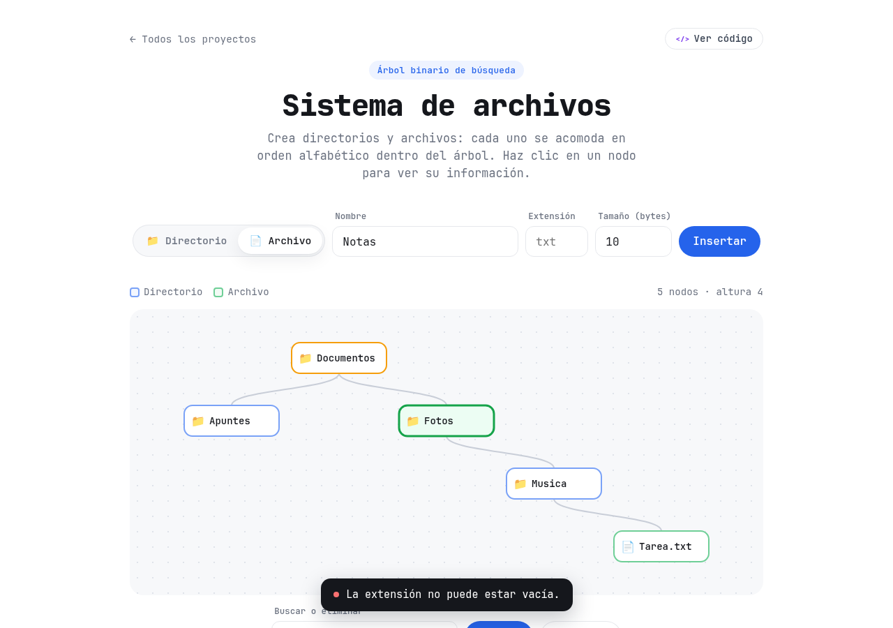

**Figura 5.15.** Búsqueda de `Indice`: se resalta el camino y se muestra la ficha (R3, R8).

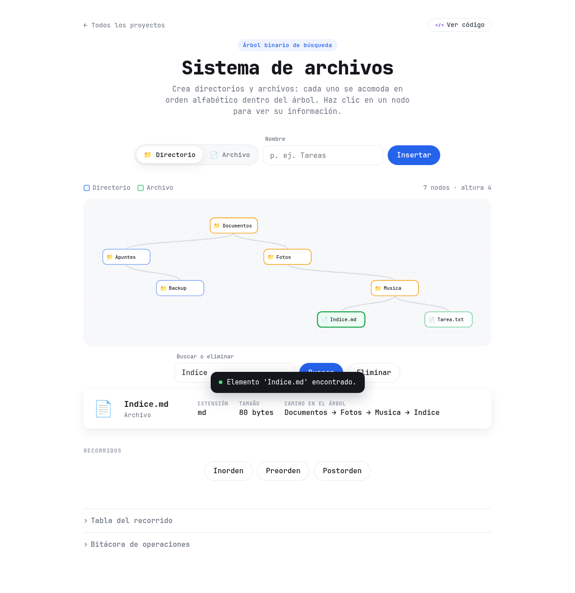

**Figura 5.16.** Búsqueda de un elemento inexistente (R3).

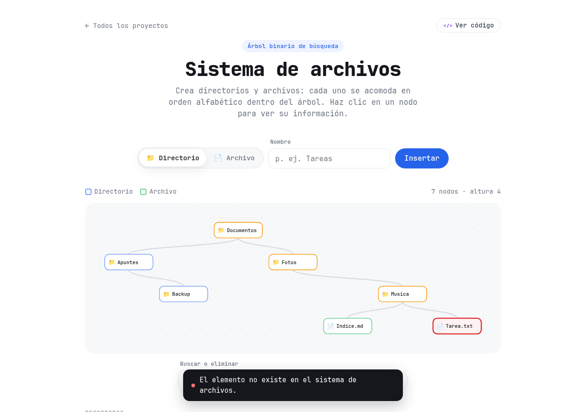

**Figura 5.17.** Recorrido inorden numerado sobre el árbol (R5).


**Figura 5.18.** Recorrido preorden (R6).


**Figura 5.19.** Recorrido postorden (R7).


**Figura 5.20.** Intento de eliminar la raíz (R4).

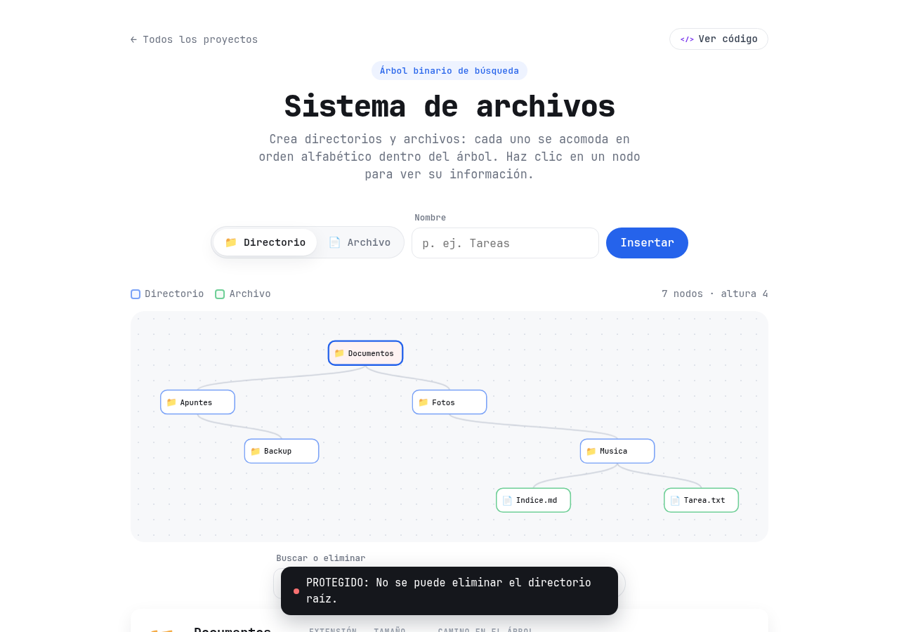

**Figura 5.21.** Confirmación antes de eliminar `Backup` (R4).


**Figura 5.22.** Árbol sin `Backup` (R4).


**Conclusión:** la inserción respeta el orden alfabético y las reglas del sistema de archivos. Los tres recorridos dan las secuencias calculadas a mano y la eliminación protege la raíz.

---

# Proyecto 6 — Ruta mágica

> **Estructura de datos:** Grafos (Dijkstra) · **Carpeta en el repositorio:** `ruta-magica/`

## 6.1 Fase 1. Contextualización

### ¿Qué se debe hacer?

Calcular la **ruta más corta por carretera** entre los Pueblos Mágicos de **Yucatán**. Los pueblos se modelan como un **grafo no dirigido y ponderado** y la ruta se obtiene con un algoritmo clásico de caminos mínimos. Hay dos versiones:

- **Consola (Python):** muestra el grado de cada vértice y la matriz de adyacencia, pide origen y destino e imprime la mejor ruta con su distancia.
- **Web (HTML + JavaScript):** dibuja el grafo como un mapa. El origen y el destino se eligen en listas o con clics, y la ruta se anima tramo por tramo. Usa las mismas clases y el mismo algoritmo traducidos a JavaScript.

### ¿Qué se necesita?

- Las clases **Vértice**, **Arista** y **Grafo**, con validaciones (sin lazos ni aristas repetidas y pesos positivos).
- Los datos reales: los Pueblos Mágicos del estado y las distancias por carretera entre pueblos vecinos (investigadas en las fuentes de las [Referencias](#referencias-bibliográficas)).
- Una **matriz de adyacencia** con 0 en la diagonal, el peso de la arista si hay conexión directa e ∞ si no la hay.
- El **algoritmo de Dijkstra**, más la reconstrucción de la ruta a partir de los predecesores.

### ¿Qué elementos se identifican?

| Elemento | En el problema | En el grafo |
|---|---|---|
| Pueblos Mágicos y Mérida | Maní, Espita, Izamal, Motul, Sisal, Tekax, Valladolid y Mérida (como nodo de conexión) | **Vértices** (8) |
| Carreteras directas | Tramos entre pueblos vecinos | **Aristas** (8) |
| Distancia en km | Longitud del tramo | **Peso** de la arista |
| Doble sentido | Se puede ir y volver por la misma carretera | Grafo **no dirigido** |
| Ruta | Secuencia de pueblos | **Camino** de costo mínimo |

**Datos del grafo:**

| Arista | km | | Arista | km |
|---|---|---|---|---|
| Sisal – Mérida | 54 | | Izamal – Espita | 76 |
| Mérida – Motul | 43 | | Espita – Valladolid | 51 |
| Motul – Izamal | 38 | | Mérida – Maní | 95 |
| Mérida – Izamal | 71 | | Maní – Tekax | 39 |

### Elección del algoritmo

| Algoritmo | ¿Sirve aquí? | Motivo |
|---|---|---|
| **Dijkstra** ✅ | Sí | Todas las distancias son **positivas** y se pide la ruta desde **un origen**. Con matriz de adyacencia cuesta O(V²), suficiente para 8 vértices. |
| Floyd-Warshall | Innecesario | Calcula **todos los pares** (O(V³)) cuando solo se necesita un origen por consulta. |
| Bellman-Ford | Innecesario | Admite pesos negativos, que no existen en distancias por carretera, y es más lento: O(V·E). |

---

## 6.2 Fase 2. Definición de los requerimientos funcionales

| ID | Requerimiento |
|---|---|
| R1 | Cargar el grafo de Pueblos Mágicos |
| R2 | Mostrar la información del grafo (grados y matriz de adyacencia) |
| R3 | Elegir el origen con validación |
| R4 | Elegir el destino con validación |
| R5 | Calcular la ruta más corta con Dijkstra |
| R6 | Mostrar la ruta completa y la distancia total |
| R7 | Manejar el caso de origen igual a destino |

| | |
|---|---|
| **Nombre** | R1 – Cargar el grafo de Pueblos Mágicos |
| **Descripción** | Crea el grafo con Mérida como vértice inicial, inserta los 7 Pueblos Mágicos y las 8 aristas con sus distancias. `insert_edge` rechaza lazos y aristas repetidas, y `Edge` rechaza pesos no positivos. |
| **Entrada** | Datos del código (`create_graph()`) |
| **Salidas** | Grafo en memoria con 8 vértices y 8 aristas |

| | |
|---|---|
| **Nombre** | R2 – Mostrar la información del grafo |
| **Descripción** | Muestra el grado de cada vértice (número de aristas incidentes) y la matriz de adyacencia de 8 × 8. |
| **Entrada** | — (al iniciar) |
| **Salidas** | `Vértice 'Mérida': 4` … y la tabla "Matriz de adyacencia" con `inf` donde no hay conexión |

| | |
|---|---|
| **Nombre** | R3 – Elegir el origen con validación |
| **Descripción** | Pide el nombre del pueblo de origen y vuelve a pedirlo si no es un vértice del grafo. En la web se elige de una lista o con un clic en el mapa. |
| **Entrada** | Nombre. Ej.: `sisal` (inválido), `Sisal` |
| **Salidas** | `[ERROR]: El destino 'sisal' es inválido, reintente…` / origen aceptado |

| | |
|---|---|
| **Nombre** | R4 – Elegir el destino con validación |
| **Descripción** | Igual que R3, para el destino. |
| **Entrada** | Nombre. Ej.: `Valladolid` |
| **Salidas** | Destino aceptado |

| | |
|---|---|
| **Nombre** | R5 – Calcular la ruta más corta con Dijkstra |
| **Descripción** | Sobre la matriz de adyacencia, toma en cada paso el vértice no visitado más cercano y **relaja** sus aristas: si pasar por él acorta la distancia a un vecino, la actualiza y guarda el predecesor. Si el destino queda en ∞, informa que no es alcanzable. |
| **Entrada** | Matriz de adyacencia, índice de origen |
| **Salidas** | Arreglo de mejores distancias y arreglo de predecesores |

| | |
|---|---|
| **Nombre** | R6 – Mostrar la ruta completa y la distancia total |
| **Descripción** | Reconstruye la ruta siguiendo los predecesores desde el destino hasta el origen, la invierte y la imprime con la distancia total. En la web también se muestran los tramos con sus kilómetros y el acumulado. |
| **Entrada** | Origen y destino. Ej.: Sisal → Valladolid |
| **Salidas** | `Mejor ruta: Sisal -> Mérida -> Izamal -> Espita -> Valladolid` · `Distancia: 252 [km]` |

| | |
|---|---|
| **Nombre** | R7 – Manejar el caso de origen igual a destino |
| **Descripción** | Si el origen y el destino son el mismo pueblo, la ruta es ese pueblo y la distancia es 0. En la web aparece un aviso en lugar de calcular. |
| **Entrada** | Mérida → Mérida |
| **Salidas** | `Mejor ruta: Mérida` · `Distancia: 0 [km]` / "El origen y el destino son el mismo lugar: la distancia es 0 km." |

---

## 6.3 Fase 3. Diseño


| Clase | Atributos | Métodos |
|---|---|---|
| **Edge** | `end1: Vertex`<br>`end2: Vertex`<br>`weight: float` | `is_loop() → bool`<br>`is_parallel(edge) → bool`<br>`other_end(vertex) → Vertex`<br>`_is_valid_edge_weight(weight) → bool`<br>`_check_edge_weight(weight)` |
| **Vertex** | `name: str`<br>`incident_edges: list[Edge]` | `insert_edge(edge)`<br>`degree() → int`<br>`is_adjacent(vertex) → bool`<br>`_is_valid_vertex_name(name) → bool`<br>`_check_vertex_name(name)` |
| **Graph** | `name: str`<br>`vertices: dict[str, Vertex]` | `insert_vertex(vertex)`<br>`find_vertex(name) → Vertex`<br>`insert_edge(end1_name, end2_name, weight)`<br>`create_adjacency_matrix() → list[list[float]]`<br>`_find_vertex_index(target) → int`<br>`_is_valid_graph_name(name)`, `_check_graph_name(name)` |
| **pathfinding** *(módulo)* | — | `dijkstra(adjacency_matrix, origin_index) → (distancias, predecesores)`<br>`find_shortest_path(matriz, nombres, origen, destino) → (ruta, distancia)` |

**Relaciones:** `Graph` se compone de sus `Vertex`. Cada `Vertex` guarda la lista de sus `Edge` incidentes (lista de adyacencia) y cada `Edge` apunta a sus dos extremos. El módulo `pathfinding` trabaja sobre la matriz que genera `Graph`. No hay herencia.

**Representación:** el grafo se guarda como **lista de adyacencia** (aristas incidentes de cada vértice) y, para Dijkstra, se convierte en **matriz de adyacencia** con `create_adjacency_matrix()`.

**Versión web:** `classes.js` y `pathfinding.js` traducen las mismas clases y funciones. Se agregaron `Graph.vertexNames()` y `routeLegs()` para dibujar los tramos.

---

## 6.4 Fase 4. Codificación

### Tecnologías y archivos

| Versión | Archivos | Tecnologías |
|---|---|---|
| Consola | `version-cli/classes.py`, `pathfinding.py`, `main.py`, `user_input.py`, `pretty_print.py` | Python 3.14 + `rich` |
| Web | `version-web/classes.js`, `pathfinding.js`, `app.js`, `ui.js`, `index.html`, `styles.css` | HTML5, CSS3, JavaScript, SVG |

### Matriz de adyacencia (asignaciones)

```python
for i in range(size):
    matrix.insert(i, [])
    for j in range(size):
        matrix[i].insert(j, 0 if i == j else infinity)   # 0 en la diagonal, ∞ sin conexión

for vertex in self.vertices.values():
    for incident_edge in vertex.incident_edges:
        index_end1 = self._find_vertex_index(incident_edge.end1)
        index_end2 = self._find_vertex_index(incident_edge.end2)
        matrix[index_end1][index_end2] = incident_edge.weight   # no dirigido: simétrica
        matrix[index_end2][index_end1] = incident_edge.weight
```

### Dijkstra (fórmula de relajación)

```python
best_distances = [infinity] * row_count
predecessors = [None] * row_count
visited = [False] * row_count
best_distances[origin_index] = 0

while True:
    candidate_index = None                     # vértice no visitado más cercano
    for index in range(row_count):
        if visited[index] or best_distances[index] == infinity:
            continue
        if candidate_index is None or best_distances[index] < best_distances[candidate_index]:
            candidate_index = index
    if candidate_index is None:
        break

    visited[candidate_index] = True
    for column_number, weight in enumerate(adjacency_matrix[candidate_index]):
        if visited[column_number] or weight == infinity:
            continue
        traversal_distance = best_distances[candidate_index] + weight      # d(u) + w(u, v)
        if traversal_distance < best_distances[column_number]:              # relajación
            best_distances[column_number] = traversal_distance
            predecessors[column_number] = candidate_index
```

### Reconstrucción de la ruta

```python
if best_distances[destination_index] == infinity:
    raise ValueError(f"The destination {destination_name!r} is unreachable for the origin {origin_name!r}")

current_index = destination_index
while current_index is not None:
    indices.append(current_index)
    current_index = predecessors[current_index]
route = [vertices_names[i] for i in reversed(indices)]
```

### Documentación del código

La explicación de cada funcionalidad está en [`CODIGO.md`](ruta-magica/CODIGO.md). Ahí se distingue el código del equipo (**[EQUIPO]**) del agregado para la interfaz web (**[IA]**). Se abre también con el botón **Ver código** de la página. Las fuentes de cada distancia están comentadas en `create_graph()` (`version-cli/main.py`).

### Instalación y uso

**Consola**

1. Instale las dependencias:

   ```shell
   pip install -r requirements.txt
   ```

2. Inicie el programa:

   ```shell
   python main.py
   ```

3. Escriba el origen y el destino tal como aparecen en la matriz: con mayúscula inicial y con acentos (por ejemplo, `Mérida`, `Maní`).

**Web:** abra `version-web/index.html` en el navegador o entre a la página publicada del proyecto. Elija el origen y el destino en las listas o con clics en el mapa y presione **Calcular ruta**.

### Limitaciones

- En consola se hace una consulta por ejecución y los nombres deben escribirse exactos (con mayúsculas y acentos).
- Las distancias son aproximadas: provienen de calculadoras de rutas en línea y pueden variar según la carretera elegida.

---

## 6.5 Fase 5. Pruebas

Casos verificados a mano con la matriz de adyacencia:

- **Sisal → Valladolid:** 54 + 71 + 76 + 51 = **252 km**. La alternativa por Motul (54 + 43 + 38 + 76 + 51 = 262 km) es más larga.
- **Tekax → Motul:** 39 + 95 + 43 = **177 km**. La alternativa por Izamal (39 + 95 + 71 + 38 = 243 km) es más larga.

| Req. | Prueba | Resultado esperado | Resultado | Evidencia |
|---|---|---|---|---|
| R1, R2 | Iniciar el programa | 8 vértices; grados y matriz correctos | ✅ | Fig. 6.1, 6.5 |
| R3, R4 | `sisal` → error; `Sisal`, `Valladolid` | Error y nuevo intento; luego se acepta | ✅ | Fig. 6.2 |
| R5, R6 | Sisal → Valladolid | Sisal → Mérida → Izamal → Espita → Valladolid, 252 km | ✅ | Fig. 6.2, 6.6 |
| R5, R6 | Tekax → Motul | Tekax → Maní → Mérida → Motul, 177 km | ✅ | Fig. 6.3, 6.7 |
| R7 | Mérida → Mérida | Ruta "Mérida", 0 km | ✅ | Fig. 6.4, 6.8 |

### Versión de consola

**Figura 6.1.** Grados de los vértices y matriz de adyacencia (R1, R2).


**Figura 6.2.** Origen inválido, luego Sisal → Valladolid: 252 km (R3–R6).


**Figura 6.3.** Tekax → Motul: 177 km (R5, R6).


**Figura 6.4.** Origen igual a destino (R7).


### Versión web

**Figura 6.5.** Mapa del grafo con las distancias de cada arista (R1, R2).


**Figura 6.6.** Sisal → Valladolid: ruta resaltada, tramos y total de 252 km (R5, R6).


**Figura 6.7.** Tekax → Motul: 177 km (R5, R6).


**Figura 6.8.** Origen igual a destino: aviso de 0 km (R7).


**Conclusión:** Dijkstra encuentra la ruta mínima en todos los casos de prueba y las dos versiones dan las mismas rutas y distancias.

---

# Referencias bibliográficas

- Cairó, O., & Guardati, S. (2006). *Estructuras de datos* (3.ª ed.). McGraw-Hill.
- Cormen, T. H., Leiserson, C. E., Rivest, R. L., & Stein, C. (2022). *Introduction to Algorithms* (4.ª ed.). MIT Press.
- Dijkstra, E. W. (1959). A note on two problems in connexion with graphs. *Numerische Mathematik, 1*, 269–271.
- Drive Bestway. (s. f.). *Distancia Mérida – Maní*. https://ca.drivebestway.com/distance/m%C3%A9rida-mx/man%C3%AD-mx
- Drive Bestway. (s. f.). *Distancia Sisal – Mérida*. https://ca.drivebestway.com/distance/sisal-mx/m%C3%A9rida-mx
- Drive Bestway. (s. f.). *Mileage chart with distances between cities — Yucatán*. https://www.drivebestway.com/mileage-chart-with-distances-between-cities/mx-yucatan
- FastAPI. (2026). *Handling Errors*. https://fastapi.tiangolo.com/tutorial/handling-errors/
- FastAPI. (2026). *Request Files*. https://fastapi.tiangolo.com/tutorial/request-files/
- Hayt, W. H., Kemmerly, J. E., & Durbin, S. M. (2019). *Análisis de circuitos en ingeniería* (9.ª ed.). McGraw-Hill.
- International Electrotechnical Commission. (2016). *IEC 60062:2016 — Marking codes for resistors and capacitors*. IEC.
- Mozilla. (2026). *MDN Web Docs — Array*. https://developer.mozilla.org/es/docs/Web/JavaScript/Reference/Global_Objects/Array
- Mozilla. (2026). *MDN Web Docs — Array.prototype.push() / pop()*. https://developer.mozilla.org/es/docs/Web/JavaScript/Reference/Global_Objects/Array/pop
- Mozilla. (2026). *MDN Web Docs — SVG*. https://developer.mozilla.org/es/docs/Web/SVG
- Mozilla. (2026). *MDN Web Docs — URL.canParse()*. https://developer.mozilla.org/en-US/docs/Web/API/URL/canParse_static
- Mozilla. (2026). *MDN Web Docs — Window.close()*. https://developer.mozilla.org/en-US/docs/Web/API/Window/close
- Python Software Foundation. (2026). *Data Structures — More on Lists*. https://docs.python.org/3/tutorial/datastructures.html
- Python Software Foundation. (2026). *dataclasses — Data Classes*. https://docs.python.org/3/library/dataclasses.html
- Python Software Foundation. (2026). *The Python Tutorial — Classes*. https://docs.python.org/3/tutorial/classes.html
- Python Software Foundation. (2026). *Using Lists as Queues*. https://docs.python.org/3/tutorial/datastructures.html#using-lists-as-queues
- React. (2026). *Documentación oficial de React*. https://es.react.dev/
- Rome2Rio. (s. f.). *Espita – Valladolid*. https://www.rome2rio.com/map/Espita-Municipality/Valladolid-Yucat%C3%A1n-Mexico
- Rome2Rio. (s. f.). *Izamal – Espita*. https://www.rome2rio.com/es/map/Municipio-de-Izamal/Municipio-de-Espita
- Rome2Rio. (s. f.). *Maní – Tekax*. https://www.rome2rio.com/map/Man%C3%AD-Municipality/Tekax-Municipality
- Secretaría de Turismo. (s. f.). *Pueblos Mágicos de México*. Gobierno de México. https://www.gob.mx/sectur
- Textualize. (2026). *Rich documentation — Tables*. https://rich.readthedocs.io/en/stable/tables.html
- Vite. (2026). *Guía de Vite*. https://vite.dev/guide/
- Wikipedia. (s. f.). *Electronic color code*. https://en.wikipedia.org/wiki/Electronic_color_code
