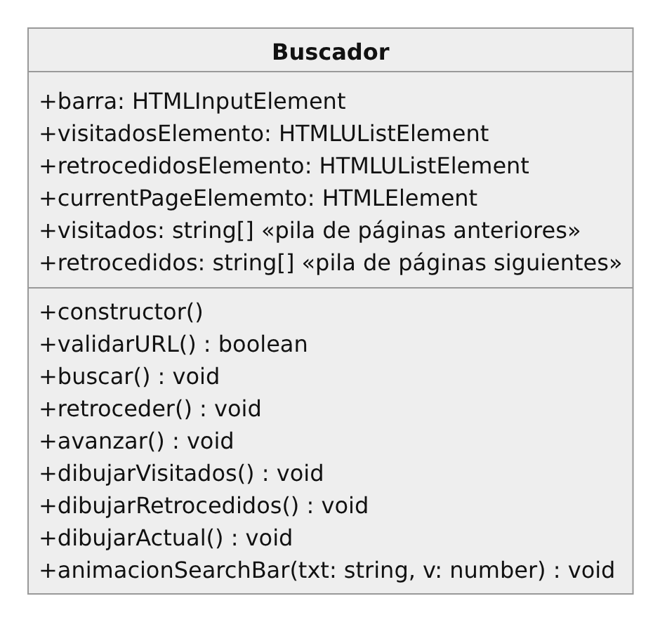
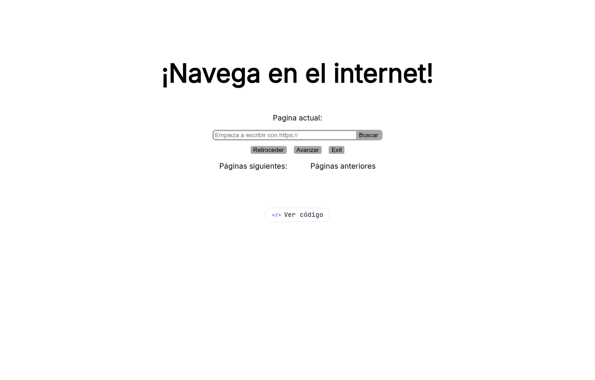
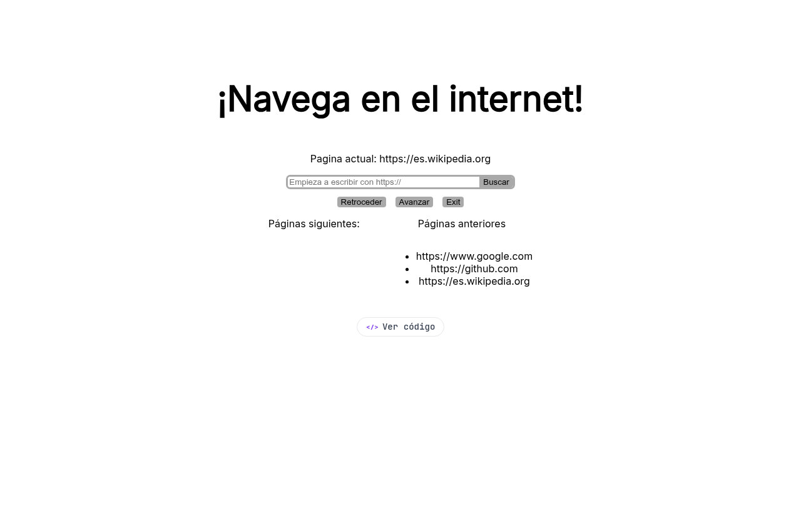
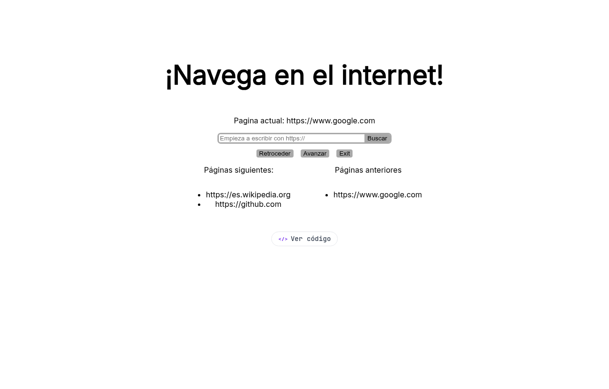
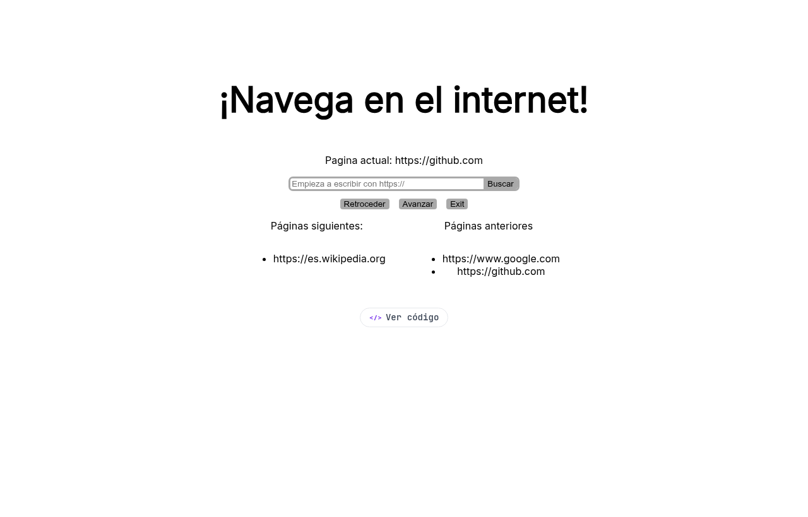
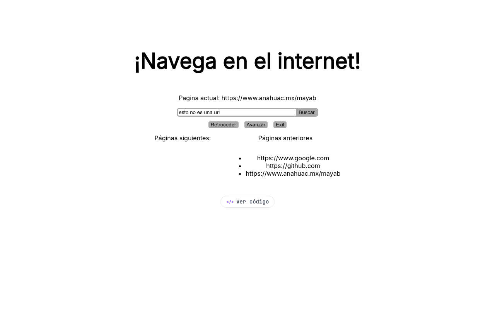

<div align="center">

**UNIVERSIDAD ANÁHUAC MAYAB**

# Proyecto 3 — Navegador web

### Documentación del proyecto (PAIF)

**Estructuras de Datos y Algoritmos** · NRC 50560<br>
Estructura de datos: **Pilas (LIFO)**

Docente: Lizbeth Hernández Olan

**Integrantes del equipo**<br>
Alejandro Cervera Castillo · Gael Hernández Lozano · Mario Andrés Zaldívar de la Cruz · Rodolfo Concha Canto

Mérida, Yucatán · Noviembre de 2026

</div>

---

## Índice

1. [Fase 1. Contextualización](#fase-1-contextualización)
2. [Fase 2. Requerimientos funcionales](#fase-2-definición-de-los-requerimientos-funcionales)
3. [Fase 3. Diseño](#fase-3-diseño)
4. [Fase 4. Codificación](#fase-4-codificación)
5. [Fase 5. Pruebas](#fase-5-pruebas)
6. [Referencias](#referencias)

---

## Fase 1. Contextualización

### ¿Qué se debe hacer?

Simular el historial de un navegador web con **dos pilas**. El usuario puede visitar una dirección, **regresar** a la página anterior, **avanzar** a la página de la que regresó y **salir**. Las operaciones deben respetar el orden LIFO (el último en entrar es el primero en salir). Visitar una página nueva borra las páginas a las que se podía avanzar.

### ¿Qué se necesita?

- Una **pila de páginas visitadas** (historial). Su tope es la página actual y debajo quedan las anteriores.
- Una **pila de páginas siguientes**, donde se guardan las páginas de las que se regresó.
- Las operaciones `push` (apilar) y `pop` (desapilar) sobre ambas pilas.
- Validar que la dirección escrita sea una URL válida y no ejecutar `pop` sobre una pila vacía.
- Una interfaz que muestre la página actual y el contenido de ambas pilas.

### ¿Qué elementos se identifican?

| Elemento | Descripción |
|---|---|
| URL | Dirección que escribe el usuario (debe empezar con `https://`, `http://`, etc.). |
| Pila de visitadas (`visitados`) | Historial; el tope es la página actual. |
| Pila de siguientes (`retrocedidos`) | Páginas a las que se puede avanzar después de regresar. |
| Página actual | Tope de la pila de visitadas. |
| Acciones | Buscar (visitar), Retroceder, Avanzar y Exit. |

### Reglas de operación

| Acción | Efecto sobre las pilas |
|---|---|
| Visitar URL | `push(url)` en visitadas; la pila de siguientes **se vacía**. |
| Retroceder | `pop()` de visitadas y `push` de esa página en siguientes. |
| Avanzar | `pop()` de siguientes y `push` de esa página en visitadas. |
| Exit | Cierra la ventana del navegador. |

---

## Fase 2. Definición de los requerimientos funcionales

| ID | Requerimiento |
|---|---|
| R1 | Visitar una página ingresando una URL |
| R2 | Retroceder a la página anterior |
| R3 | Avanzar a la página siguiente |
| R4 | Limpiar la pila de siguientes al visitar una página nueva |
| R5 | Mostrar la página actual y ambas pilas en todo momento |
| R6 | Evitar errores con URL inválida o pila vacía |
| R7 | Salir del programa |

| | |
|---|---|
| **Nombre** | R1 – Visitar una página ingresando una URL |
| **Descripción** | Valida la dirección con `URL.canParse`. Si es válida, la apila en la pila de visitadas, la convierte en la página actual y limpia la barra. Se activa con el botón **Buscar** o con la tecla Enter. |
| **Entrada** | URL. Ej.: `https://www.google.com` |
| **Salidas** | `Pagina actual: https://www.google.com` y la URL en la lista de páginas anteriores |

| | |
|---|---|
| **Nombre** | R2 – Retroceder a la página anterior |
| **Descripción** | Si la pila de visitadas no está vacía, desapila su tope y lo apila en la pila de siguientes. La nueva página actual es el nuevo tope. |
| **Entrada** | Botón **Retroceder** |
| **Salidas** | Página actual = página anterior; la página que se dejó aparece en "Páginas siguientes" |

| | |
|---|---|
| **Nombre** | R3 – Avanzar a la página siguiente |
| **Descripción** | Si la pila de siguientes no está vacía, desapila su tope y lo apila otra vez en la pila de visitadas. |
| **Entrada** | Botón **Avanzar** |
| **Salidas** | Página actual = página de la que se había regresado |

| | |
|---|---|
| **Nombre** | R4 – Limpiar la pila de siguientes al visitar una página nueva |
| **Descripción** | Visitar una URL nueva reinicia la pila de siguientes (`this.retrocedidos = []`), igual que en un navegador real. |
| **Entrada** | URL nueva después de haber retrocedido |
| **Salidas** | Lista "Páginas siguientes" vacía |

| | |
|---|---|
| **Nombre** | R5 – Mostrar la página actual y ambas pilas en todo momento |
| **Descripción** | Después de cada operación se dibujan la página actual (`dibujarActual`) y el contenido de las dos pilas (`dibujarVisitados`, `dibujarRetrocedidos`). |
| **Entrada** | — (después de cada acción) |
| **Salidas** | Texto "Pagina actual" y las listas "Páginas anteriores" y "Páginas siguientes" |

| | |
|---|---|
| **Nombre** | R6 – Evitar errores con URL inválida o pila vacía |
| **Descripción** | Una URL inválida no se apila. Retroceder o avanzar con la pila correspondiente vacía no hace nada, así que nunca se ejecuta `pop` sobre una pila vacía. |
| **Entrada** | `esto no es una url`, o Retroceder/Avanzar sin páginas |
| **Salidas** | Las pilas y la página actual no cambian |

| | |
|---|---|
| **Nombre** | R7 – Salir del programa |
| **Descripción** | El botón **Exit** llama a `window.close()` para cerrar la ventana. |
| **Entrada** | Botón **Exit** |
| **Salidas** | Se cierra la ventana (si el navegador lo permite) |

---

## Fase 3. Diseño



| Clase | Atributos | Métodos |
|---|---|---|
| **Buscador** | `visitados: string[]` — pila de páginas visitadas (tope = actual)<br>`retrocedidos: string[]` — pila de páginas siguientes<br>`barra: HTMLInputElement`<br>`visitadosElemento`, `retrocedidosElemento`, `currentPageElememto` (elementos de la página) | `validarURL() → boolean`<br>`buscar()`<br>`retroceder()`<br>`avanzar()`<br>`dibujarVisitados()`<br>`dibujarRetrocedidos()`<br>`dibujarActual()`<br>`animacionSearchBar(txt, v)` |

Las dos pilas se implementan con arreglos de JavaScript y **solo** se modifican por el final con `push` y `pop`, que es la disciplina LIFO. No hay herencia.

---

## Fase 4. Codificación

### Tecnologías y archivos

| Archivo | Contenido |
|---|---|
| `index.html` | Barra de URL, botones y listas de las pilas |
| `buscador.js` | Clase `Buscador` y eventos (escrito por el equipo) |
| `styles.css` | Estilos de la interfaz |

Tecnologías: HTML5, CSS3 y JavaScript, sin librerías externas.

### Operaciones de pila

```js
buscar() {
  if (this.validarURL()) {                 // condicional: solo URLs válidas
    this.visitados.push(this.barra.value); // push en la pila de visitadas
    this.barra.value = "";
    this.retrocedidos = [];                // R4: se vacía la pila de siguientes
    this.dibujarVisitados();
    this.dibujarRetrocedidos();
    this.dibujarActual();
  }
}

retroceder() {
  if (this.visitados.length !== 0) {                     // evita pop en pila vacía
    this.retrocedidos.push(this.visitados.pop());        // pop de una pila, push en la otra
    /* … se vuelve a dibujar … */
  }
}

avanzar() {
  if (this.retrocedidos.length !== 0) {
    this.visitados.push(this.retrocedidos.pop());
    /* … */
  }
}
```

### Página actual (asignación desde el tope)

```js
dibujarActual() {
  const actual = this.visitados[this.visitados.length - 1]; // peek: tope de la pila
  this.currentPageElememto.textContent = actual ? `Pagina actual: ${actual}` : "Pagina actual: ";
}
```

### Documentación del código

La explicación de cada fragmento está en [`CODIGO.md`](CODIGO.md). También se puede abrir con el botón **Ver código** de la página.

### Uso

1. Abra `index.html` en el navegador o entre a la página publicada del proyecto.
2. Escriba una URL que empiece con `https://` y presione **Buscar** o Enter.
3. Use **Retroceder** y **Avanzar** para moverse por el historial.

### Limitaciones

- Una URL inválida o una pila vacía se ignoran sin mostrar mensaje.
- `window.close()` solo cierra ventanas que se abrieron desde un script; en una pestaña normal el navegador puede bloquearlo.

---

## Fase 5. Pruebas

Secuencia de prueba: visitar `google.com` → `github.com` → `es.wikipedia.org`, retroceder dos veces, avanzar una vez, visitar `anahuac.mx/mayab` y escribir una URL inválida.

| Req. | Prueba | Resultado esperado | Resultado | Evidencia |
|---|---|---|---|---|
| R1, R5 | Visitar 3 URLs | Actual: wikipedia; anteriores: google, github, wikipedia | ✅ | Fig. 2 |
| R2 | Retroceder ×2 | Actual: google; siguientes: wikipedia, github | ✅ | Fig. 3 |
| R3 | Avanzar ×1 | Actual: github; siguientes: wikipedia | ✅ | Fig. 4 |
| R4 | Visitar anahuac.mx/mayab | Siguientes vacía; actual: anahuac | ✅ | Fig. 5 |
| R6 | `esto no es una url` | Sin cambios en las pilas | ✅ | Fig. 6 |
| R7 | Botón Exit | Llama a `window.close()` | ✅ (ver limitación) | — |

**Figura 1.** Estado inicial: ambas pilas vacías.



**Figura 2.** Después de visitar tres páginas, la actual es el tope de la pila de visitadas (R1, R5).



**Figura 3.** Después de retroceder dos veces, las páginas pasan a la pila de siguientes (R2).



**Figura 4.** Al avanzar, `github.com` vuelve a la pila de visitadas (R3).



**Figura 5.** Al visitar una página nueva se vacía la pila de siguientes (R4).


**Figura 6.** Una URL inválida no modifica las pilas (R6).



**Conclusión:** las dos pilas respetan el orden LIFO. Retroceder y avanzar mueven la página del tope de una pila a la otra, y visitar una página nueva vacía la pila de siguientes.

---

## Referencias

- Mozilla. (2026). *MDN Web Docs — Array.prototype.push() / pop()*. https://developer.mozilla.org/es/docs/Web/JavaScript/Reference/Global_Objects/Array/pop
- Mozilla. (2026). *MDN Web Docs — URL.canParse()*. https://developer.mozilla.org/en-US/docs/Web/API/URL/canParse_static
- Mozilla. (2026). *MDN Web Docs — Window.close()*. https://developer.mozilla.org/en-US/docs/Web/API/Window/close
- Cormen, T. H., Leiserson, C. E., Rivest, R. L., & Stein, C. (2022). *Introduction to Algorithms* (4.ª ed., cap. 10.1 "Stacks and queues"). MIT Press.
