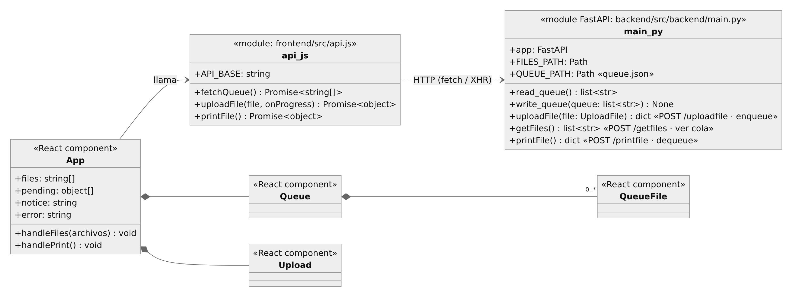
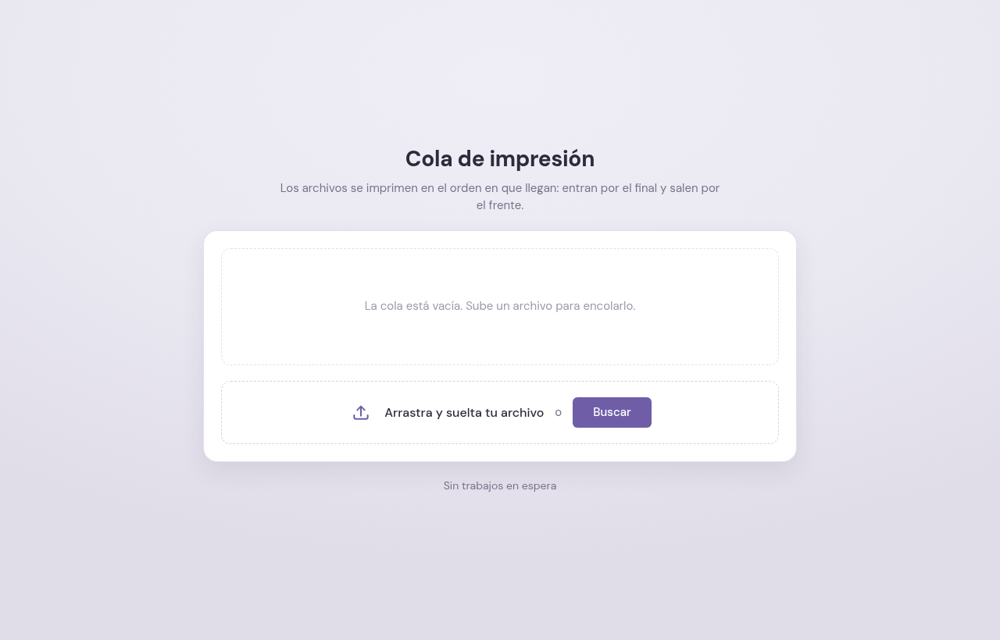
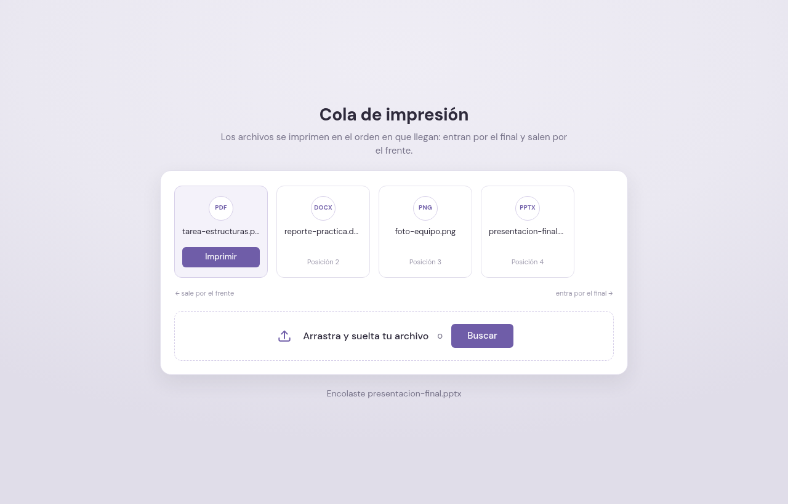
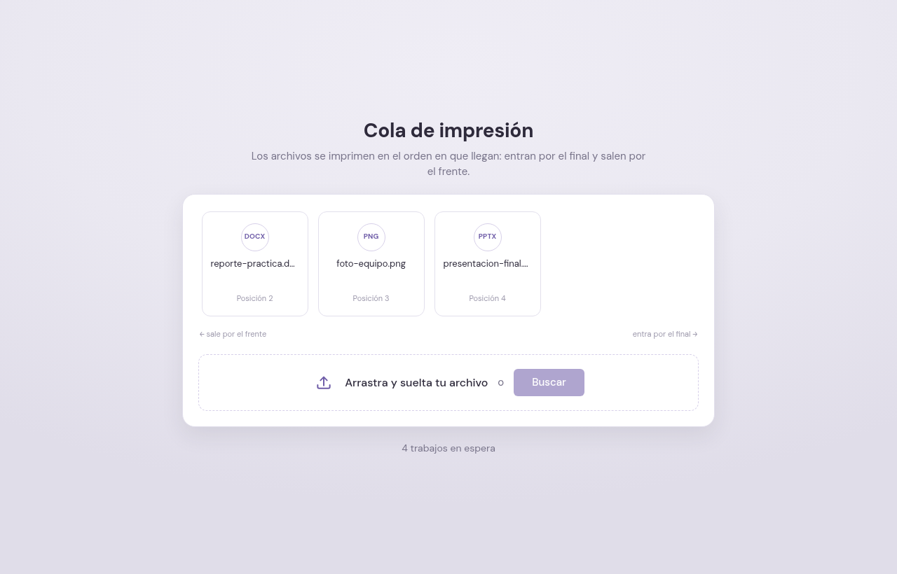
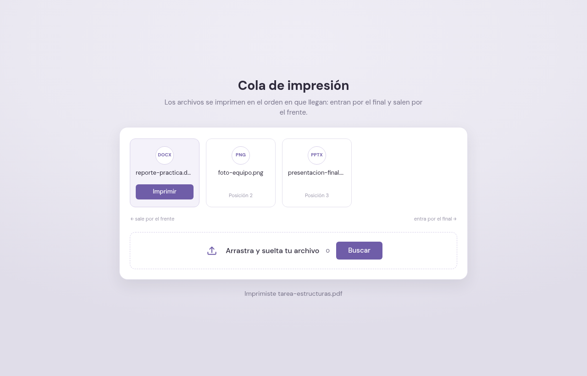
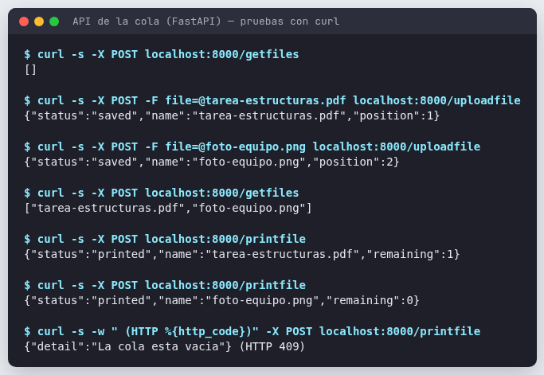

<div align="center">

**UNIVERSIDAD ANÁHUAC MAYAB**

# Proyecto 4 — Cola de impresión

### Documentación del proyecto (PAIF)

**Estructuras de Datos y Algoritmos** · NRC 50560<br>
Estructura de datos: **Colas (FIFO)**

Docente: Lizbeth Hernández Olan

**Integrantes del equipo**<br>
Alejandro Cervera Castillo · Gael Hernández Lozano · Mario Andrés Zaldívar de la Cruz · Rodolfo Concha Canto

Mérida, Yucatán · Noviembre de 2026

</div>

---

## Índice

1. [Fase 1. Contextualización](#fase-1-contextualización)
2. [Fase 2. Requerimientos funcionales](#fase-2-definición-de-los-requerimientos-funcionales)
3. [Fase 3. Diseño](#fase-3-diseño)
4. [Fase 4. Codificación](#fase-4-codificación)
5. [Fase 5. Pruebas](#fase-5-pruebas)
6. [Referencias](#referencias)

---

## Fase 1. Contextualización

### ¿Qué se debe hacer?

Implementar la **cola de impresión** de una impresora con la estructura de datos **cola** (FIFO: el primero en entrar es el primero en salir). Los trabajos nuevos se **encolan al final** y, al imprimir, se **desencola el del frente**, es decir, el más antiguo.

Para hacerlo, el equipo programó una aplicación *fullstack*:

- **Backend (API con FastAPI, Python):** guarda la cola de forma persistente y expone las operaciones de la cola como *endpoints*.
- **Frontend (React + Vite, JavaScript):** permite subir archivos para encolarlos, muestra la cola en orden y tiene el botón **Imprimir** sobre el trabajo del frente.

### ¿Qué se necesita?

- Una estructura cola con las operaciones **encolar** (agregar al final), **desencolar** (quitar del frente) y **consultar** (ver la cola completa).
- Persistencia: la cola se guarda en `queue.json` y los archivos en la carpeta `files/` del servidor. Así, cualquier computadora que abra la aplicación ve la misma cola.
- Una interfaz para subir archivos (arrastrar y soltar o botón **Buscar**) e imprimir.
- Manejo del caso de cola vacía.

### ¿Qué elementos se identifican?

| Elemento | Descripción |
|---|---|
| Trabajo de impresión | Archivo subido por el usuario (se identifica por su nombre). |
| Cola | Lista ordenada de nombres; el índice 0 es el **frente**. |
| Frente | Siguiente trabajo que se imprimirá. |
| Final | Posición donde entra cada trabajo nuevo. |
| `queue.json` | Archivo donde se guarda la cola. |
| `files/` | Carpeta donde se guardan los archivos encolados. |
| Endpoints | `POST /uploadfile` (encolar), `POST /getfiles` (consultar), `POST /printfile` (desencolar). |

---

## Fase 2. Definición de los requerimientos funcionales

| ID | Requerimiento |
|---|---|
| R1 | Agregar trabajos a la cola (encolar al final) |
| R2 | Imprimir el trabajo del frente (desencolar) |
| R3 | Mostrar la cola en orden de atención |
| R4 | Manejar la cola vacía |

| | |
|---|---|
| **Nombre** | R1 – Agregar trabajos a la cola |
| **Descripción** | El usuario sube uno o varios archivos (arrastrándolos o con el botón **Buscar**). La API guarda cada archivo en `files/` y **agrega su nombre al final** de la lista en `queue.json`. Responde con la posición que ocupa. |
| **Entrada** | Uno o más archivos. Ej.: `tarea-estructuras.pdf` |
| **Salidas** | `{"status":"saved","name":"tarea-estructuras.pdf","position":1}` · en pantalla: tarjeta al final de la cola y el aviso "Encolaste …" |

| | |
|---|---|
| **Nombre** | R2 – Imprimir el trabajo del frente |
| **Descripción** | Al presionar **Imprimir**, la API saca el **primer** elemento de la cola (`pop(0)`), borra su archivo de `files/` y guarda la cola actualizada. Los demás trabajos avanzan una posición. |
| **Entrada** | Botón **Imprimir** (solo aparece sobre el trabajo del frente) |
| **Salidas** | `{"status":"printed","name":"tarea-estructuras.pdf","remaining":3}` · en pantalla: "Imprimiste tarea-estructuras.pdf" |

| | |
|---|---|
| **Nombre** | R3 – Mostrar la cola en orden de atención |
| **Descripción** | La interfaz consulta `POST /getfiles` y dibuja los trabajos de izquierda (frente) a derecha (final), con su posición y su tipo de archivo. Debajo muestra cuántos trabajos hay en espera. |
| **Entrada** | — (al cargar la página y después de cada operación) |
| **Salidas** | `["tarea-estructuras.pdf","reporte-practica.docx", …]` · tarjetas "Posición 1, 2, 3…" |

| | |
|---|---|
| **Nombre** | R4 – Manejar la cola vacía |
| **Descripción** | Si no hay trabajos, la interfaz muestra "La cola está vacía" y no muestra el botón **Imprimir**. Si se llama a `/printfile` con la cola vacía, la API responde con error **409** en lugar de fallar. |
| **Entrada** | Imprimir cuando no hay trabajos |
| **Salidas** | `{"detail":"La cola esta vacia"}` (HTTP 409) · en pantalla: "La cola está vacía. Sube un archivo para encolarlo." |

---

## Fase 3. Diseño

En lugar de una clase `Queue`, el equipo implementó la cola como una **API** cuyos *endpoints* equivalen a los métodos de una cola. El estado (la lista) vive en `queue.json`, así la cola se conserva aunque se reinicie el servidor y se comparte entre todos los clientes.



| Módulo / componente | Atributos | Métodos / funciones |
|---|---|---|
| **main.py** (API FastAPI) | `app: FastAPI`<br>`FILES_PATH: Path`<br>`QUEUE_PATH: Path` (`queue.json`) | `read_queue() → list[str]`<br>`write_queue(queue)`<br>`uploadFile(file) → dict` — **encolar**<br>`getFiles() → list[str]` — **consultar**<br>`printFile() → dict` — **desencolar** |
| **api.js** (cliente) | `API_BASE` | `fetchQueue()`<br>`uploadFile(file, onProgress)`<br>`printFile()` |
| **App** (React) | estado: `files`, `pending`, `notice`, `error`, `printing` | `handleFiles(archivos)`<br>`handlePrint()`<br>`refresh()` |
| **Queue**, **QueueFile**, **Upload** (React) | *props* recibidas de `App` | Dibujan la cola, cada tarjeta y la zona de carga |

| Operación de cola | Endpoint | Implementación |
|---|---|---|
| `enqueue(x)` | `POST /uploadfile` | `queue.append(file_name)` |
| `dequeue()` | `POST /printfile` | `queue.pop(0)` |
| `peek()` / recorrer | `POST /getfiles` | `return read_queue()` |
| `isEmpty()` | (dentro de `/printfile`) | `if not queue: raise HTTPException(409)` |

---

## Fase 4. Codificación

### Tecnologías y archivos

| Parte | Archivos | Tecnologías |
|---|---|---|
| Backend | `backend/src/backend/main.py`, `queue.json`, `files/` | Python 3.14, FastAPI, Uvicorn, gestor `uv` |
| Frontend | `frontend/src/App.jsx`, `api.js`, `components/Queue.jsx`, `QueueFile.jsx`, `Upload.jsx` | React, Vite, JavaScript, CSS |

### Encolar (al final)

```python
@app.post("/uploadfile")
def uploadFile(file: UploadFile = File(...)):
    """Encola un archivo: lo guarda en disco y lo agrega al final."""
    file_name = os.path.basename(file.filename)
    with open(FILES_PATH / file_name, "wb") as buffer:
        shutil.copyfileobj(file.file, buffer)

    queue = read_queue()
    queue.append(file_name)          # enqueue
    write_queue(queue)
    return {"status": "saved", "name": file_name, "position": len(queue)}
```

### Desencolar (del frente) y cola vacía

```python
@app.post("/printfile")
def printFile():
    """Imprime: saca el archivo del frente de la cola y lo borra del disco."""
    queue = read_queue()
    if not queue:                                        # condicional: cola vacía
        raise HTTPException(status_code=409, detail="La cola esta vacia")

    file_name = queue.pop(0)                             # dequeue (FIFO)
    (FILES_PATH / file_name).unlink(True)
    write_queue(queue)
    return {"status": "printed", "name": file_name, "remaining": len(queue)}
```

### Cliente (frontend)

```js
/** Imprime: saca el archivo del frente de la cola. */
export async function printFile() {
  const response = await fetch(`${API_BASE}/printfile`, { method: "POST" });
  const texto = await response.text();
  if (!response.ok) throw new Error(leerDetalle(texto, "No se pudo imprimir el archivo."));
  return JSON.parse(texto);
}
```

### Documentación del código

Cada función del backend tiene un *docstring* que dice qué operación de la cola realiza. En `api.js` cada función tiene un comentario JSDoc.

### Instalación y uso

1. **Backend** (en `backend/`):

   ```shell
   uv sync
   uv run uvicorn --app-dir src backend.main:app --port 8000
   ```

2. **Frontend** (en `frontend/`):

   ```shell
   npm install
   npm run dev
   ```

3. Abra `http://localhost:5173`. Para apuntar a otra dirección de la API, copie `.env.example` como `.env` y cambie `VITE_API_URL`.

### Limitaciones

- No puede publicarse en GitHub Pages porque necesita el servidor FastAPI en ejecución.
- Los archivos se identifican por su nombre; si se sube dos veces un archivo con el mismo nombre, la segunda copia reemplaza a la primera en disco.

---

## Fase 5. Pruebas

| Req. | Prueba | Resultado esperado | Resultado | Evidencia |
|---|---|---|---|---|
| R4 | Abrir la aplicación sin trabajos | "La cola está vacía…" | ✅ | Fig. 1 |
| R1 | Subir `tarea-estructuras.pdf` | Queda en la posición 1 | ✅ | Fig. 2 |
| R1, R3 | Subir 3 archivos más | Quedan en las posiciones 2, 3 y 4, en el orden en que se subieron | ✅ | Fig. 3 |
| R2 | Imprimir | Sale `tarea-estructuras.pdf` (el más antiguo); los demás avanzan | ✅ | Fig. 4, 5 |
| R2, R4 | Imprimir hasta vaciar | Cola vacía; ya no aparece **Imprimir** | ✅ | Fig. 6 |
| R1–R4 | Probar la API con `curl` | FIFO correcto y 409 con la cola vacía | ✅ | Fig. 7 |

**Figura 1.** Cola vacía al iniciar (R4).



**Figura 2.** Primer trabajo encolado: queda al frente con el botón **Imprimir** (R1).


**Figura 3.** Cuatro trabajos en orden de llegada; el frente está a la izquierda (R1, R3).



**Figura 4.** Al imprimir, el trabajo del frente sale de la cola (animación de salida) (R2).



**Figura 5.** Después de imprimir: "Imprimiste tarea-estructuras.pdf" y los demás avanzan una posición (R2).



**Figura 6.** Después de imprimir todos los trabajos, la cola queda vacía (R2, R4).


**Figura 7.** Prueba directa de la API: encolar dos archivos, consultar, desencolar en orden FIFO y error 409 con la cola vacía (R1–R4).



**Conclusión:** los trabajos se atienden en el mismo orden en que llegan (FIFO). La API rechaza imprimir con la cola vacía sin detenerse.

---

## Referencias

- FastAPI. (2026). *Request Files*. https://fastapi.tiangolo.com/tutorial/request-files/
- FastAPI. (2026). *Handling Errors*. https://fastapi.tiangolo.com/tutorial/handling-errors/
- React. (2026). *Documentación oficial de React*. https://es.react.dev/
- Vite. (2026). *Guía de Vite*. https://vite.dev/guide/
- Python Software Foundation. (2026). *Using Lists as Queues*. https://docs.python.org/3/tutorial/datastructures.html#using-lists-as-queues
- Cormen, T. H., Leiserson, C. E., Rivest, R. L., & Stein, C. (2022). *Introduction to Algorithms* (4.ª ed., cap. 10.1 "Stacks and queues"). MIT Press.
