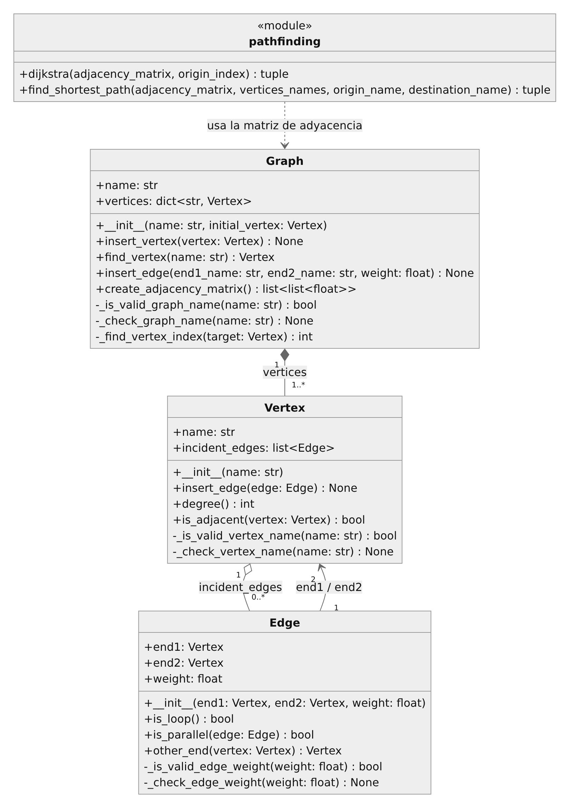
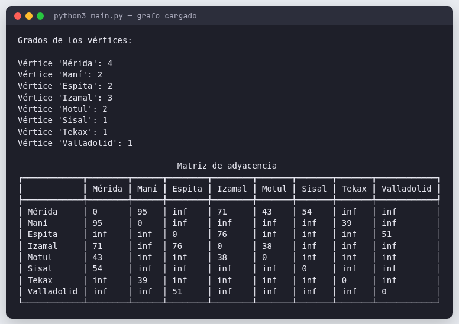
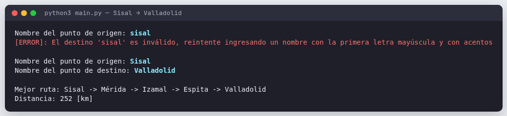
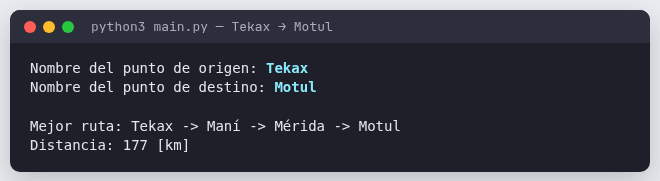
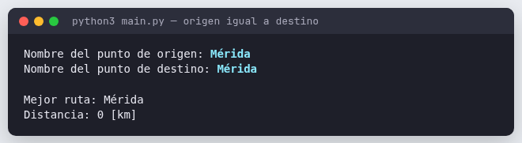
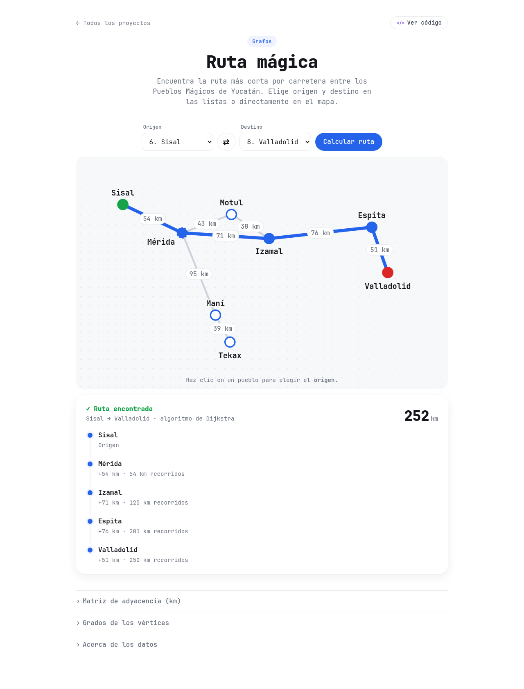
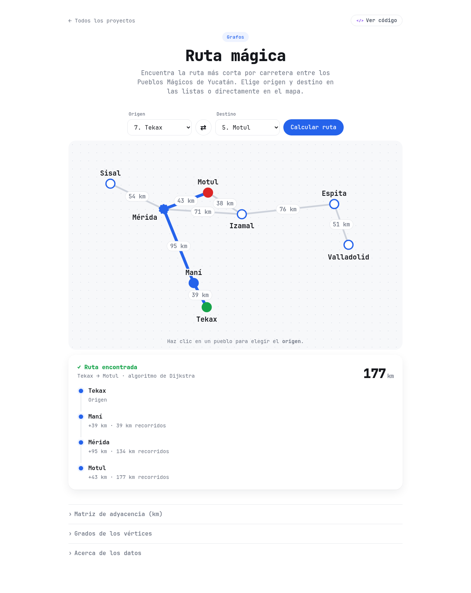

<div align="center">

**UNIVERSIDAD ANÁHUAC MAYAB**

# Proyecto 6 — Ruta mágica

### Documentación del proyecto (PAIF)

**Estructuras de Datos y Algoritmos** · NRC 50560<br>
Estructura de datos: **Grafos** · Algoritmo: **Dijkstra**

Docente: Lizbeth Hernández Olan

**Integrantes del equipo**<br>
Alejandro Cervera Castillo · Gael Hernández Lozano · Mario Andrés Zaldívar de la Cruz · Rodolfo Concha Canto

Mérida, Yucatán · Noviembre de 2026

</div>

---

## Índice

1. [Fase 1. Contextualización](#fase-1-contextualización)
2. [Fase 2. Requerimientos funcionales](#fase-2-definición-de-los-requerimientos-funcionales)
3. [Fase 3. Diseño](#fase-3-diseño)
4. [Fase 4. Codificación](#fase-4-codificación)
5. [Fase 5. Pruebas](#fase-5-pruebas)
6. [Referencias](#referencias)

---

## Fase 1. Contextualización

### ¿Qué se debe hacer?

Calcular la **ruta más corta por carretera** entre los Pueblos Mágicos de **Yucatán**. Los pueblos se modelan como un **grafo no dirigido y ponderado** y la ruta se obtiene con un algoritmo clásico de caminos mínimos. Hay dos versiones:

- **Consola (Python):** muestra el grado de cada vértice y la matriz de adyacencia, pide origen y destino e imprime la mejor ruta con su distancia.
- **Web (HTML + JavaScript):** dibuja el grafo como un mapa. El origen y el destino se eligen en listas o con clics, y la ruta se anima tramo por tramo. Usa las mismas clases y el mismo algoritmo traducidos a JavaScript.

### ¿Qué se necesita?

- Las clases **Vértice**, **Arista** y **Grafo**, con validaciones (sin lazos ni aristas repetidas y pesos positivos).
- Los datos reales: los Pueblos Mágicos del estado y las distancias por carretera entre pueblos vecinos (investigadas en las fuentes de las [Referencias](#referencias)).
- Una **matriz de adyacencia** con 0 en la diagonal, el peso de la arista si hay conexión directa e ∞ si no la hay.
- El **algoritmo de Dijkstra**, más la reconstrucción de la ruta a partir de los predecesores.

### ¿Qué elementos se identifican?

| Elemento | En el problema | En el grafo |
|---|---|---|
| Pueblos Mágicos y Mérida | Maní, Espita, Izamal, Motul, Sisal, Tekax, Valladolid y Mérida (como nodo de conexión) | **Vértices** (8) |
| Carreteras directas | Tramos entre pueblos vecinos | **Aristas** (8) |
| Distancia en km | Longitud del tramo | **Peso** de la arista |
| Doble sentido | Se puede ir y volver por la misma carretera | Grafo **no dirigido** |
| Ruta | Secuencia de pueblos | **Camino** de costo mínimo |

**Datos del grafo:**

| Arista | km | | Arista | km |
|---|---|---|---|---|
| Sisal – Mérida | 54 | | Izamal – Espita | 76 |
| Mérida – Motul | 43 | | Espita – Valladolid | 51 |
| Motul – Izamal | 38 | | Mérida – Maní | 95 |
| Mérida – Izamal | 71 | | Maní – Tekax | 39 |

### Elección del algoritmo

| Algoritmo | ¿Sirve aquí? | Motivo |
|---|---|---|
| **Dijkstra** ✅ | Sí | Todas las distancias son **positivas** y se pide la ruta desde **un origen**. Con matriz de adyacencia cuesta O(V²), suficiente para 8 vértices. |
| Floyd-Warshall | Innecesario | Calcula **todos los pares** (O(V³)) cuando solo se necesita un origen por consulta. |
| Bellman-Ford | Innecesario | Admite pesos negativos, que no existen en distancias por carretera, y es más lento: O(V·E). |

---

## Fase 2. Definición de los requerimientos funcionales

| ID | Requerimiento |
|---|---|
| R1 | Cargar el grafo de Pueblos Mágicos |
| R2 | Mostrar la información del grafo (grados y matriz de adyacencia) |
| R3 | Elegir el origen con validación |
| R4 | Elegir el destino con validación |
| R5 | Calcular la ruta más corta con Dijkstra |
| R6 | Mostrar la ruta completa y la distancia total |
| R7 | Manejar el caso de origen igual a destino |

| | |
|---|---|
| **Nombre** | R1 – Cargar el grafo de Pueblos Mágicos |
| **Descripción** | Crea el grafo con Mérida como vértice inicial, inserta los 7 Pueblos Mágicos y las 8 aristas con sus distancias. `insert_edge` rechaza lazos y aristas repetidas, y `Edge` rechaza pesos no positivos. |
| **Entrada** | Datos del código (`create_graph()`) |
| **Salidas** | Grafo en memoria con 8 vértices y 8 aristas |

| | |
|---|---|
| **Nombre** | R2 – Mostrar la información del grafo |
| **Descripción** | Muestra el grado de cada vértice (número de aristas incidentes) y la matriz de adyacencia de 8 × 8. |
| **Entrada** | — (al iniciar) |
| **Salidas** | `Vértice 'Mérida': 4` … y la tabla "Matriz de adyacencia" con `inf` donde no hay conexión |

| | |
|---|---|
| **Nombre** | R3 – Elegir el origen con validación |
| **Descripción** | Pide el nombre del pueblo de origen y vuelve a pedirlo si no es un vértice del grafo. En la web se elige de una lista o con un clic en el mapa. |
| **Entrada** | Nombre. Ej.: `sisal` (inválido), `Sisal` |
| **Salidas** | `[ERROR]: El destino 'sisal' es inválido, reintente…` / origen aceptado |

| | |
|---|---|
| **Nombre** | R4 – Elegir el destino con validación |
| **Descripción** | Igual que R3, para el destino. |
| **Entrada** | Nombre. Ej.: `Valladolid` |
| **Salidas** | Destino aceptado |

| | |
|---|---|
| **Nombre** | R5 – Calcular la ruta más corta con Dijkstra |
| **Descripción** | Sobre la matriz de adyacencia, toma en cada paso el vértice no visitado más cercano y **relaja** sus aristas: si pasar por él acorta la distancia a un vecino, la actualiza y guarda el predecesor. Si el destino queda en ∞, informa que no es alcanzable. |
| **Entrada** | Matriz de adyacencia, índice de origen |
| **Salidas** | Arreglo de mejores distancias y arreglo de predecesores |

| | |
|---|---|
| **Nombre** | R6 – Mostrar la ruta completa y la distancia total |
| **Descripción** | Reconstruye la ruta siguiendo los predecesores desde el destino hasta el origen, la invierte y la imprime con la distancia total. En la web también se muestran los tramos con sus kilómetros y el acumulado. |
| **Entrada** | Origen y destino. Ej.: Sisal → Valladolid |
| **Salidas** | `Mejor ruta: Sisal -> Mérida -> Izamal -> Espita -> Valladolid` · `Distancia: 252 [km]` |

| | |
|---|---|
| **Nombre** | R7 – Manejar el caso de origen igual a destino |
| **Descripción** | Si el origen y el destino son el mismo pueblo, la ruta es ese pueblo y la distancia es 0. En la web aparece un aviso en lugar de calcular. |
| **Entrada** | Mérida → Mérida |
| **Salidas** | `Mejor ruta: Mérida` · `Distancia: 0 [km]` / "El origen y el destino son el mismo lugar: la distancia es 0 km." |

---

## Fase 3. Diseño



| Clase | Atributos | Métodos |
|---|---|---|
| **Edge** | `end1: Vertex`<br>`end2: Vertex`<br>`weight: float` | `is_loop() → bool`<br>`is_parallel(edge) → bool`<br>`other_end(vertex) → Vertex`<br>`_is_valid_edge_weight(weight) → bool`<br>`_check_edge_weight(weight)` |
| **Vertex** | `name: str`<br>`incident_edges: list[Edge]` | `insert_edge(edge)`<br>`degree() → int`<br>`is_adjacent(vertex) → bool`<br>`_is_valid_vertex_name(name) → bool`<br>`_check_vertex_name(name)` |
| **Graph** | `name: str`<br>`vertices: dict[str, Vertex]` | `insert_vertex(vertex)`<br>`find_vertex(name) → Vertex`<br>`insert_edge(end1_name, end2_name, weight)`<br>`create_adjacency_matrix() → list[list[float]]`<br>`_find_vertex_index(target) → int`<br>`_is_valid_graph_name(name)`, `_check_graph_name(name)` |
| **pathfinding** *(módulo)* | — | `dijkstra(adjacency_matrix, origin_index) → (distancias, predecesores)`<br>`find_shortest_path(matriz, nombres, origen, destino) → (ruta, distancia)` |

**Relaciones:** `Graph` se compone de sus `Vertex`. Cada `Vertex` guarda la lista de sus `Edge` incidentes (lista de adyacencia) y cada `Edge` apunta a sus dos extremos. El módulo `pathfinding` trabaja sobre la matriz que genera `Graph`. No hay herencia.

**Representación:** el grafo se guarda como **lista de adyacencia** (aristas incidentes de cada vértice) y, para Dijkstra, se convierte en **matriz de adyacencia** con `create_adjacency_matrix()`.

**Versión web:** `classes.js` y `pathfinding.js` traducen las mismas clases y funciones. Se agregaron `Graph.vertexNames()` y `routeLegs()` para dibujar los tramos.

---

## Fase 4. Codificación

### Tecnologías y archivos

| Versión | Archivos | Tecnologías |
|---|---|---|
| Consola | `version-cli/classes.py`, `pathfinding.py`, `main.py`, `user_input.py`, `pretty_print.py` | Python 3.14 + `rich` |
| Web | `version-web/classes.js`, `pathfinding.js`, `app.js`, `ui.js`, `index.html`, `styles.css` | HTML5, CSS3, JavaScript, SVG |

### Matriz de adyacencia (asignaciones)

```python
for i in range(size):
    matrix.insert(i, [])
    for j in range(size):
        matrix[i].insert(j, 0 if i == j else infinity)   # 0 en la diagonal, ∞ sin conexión

for vertex in self.vertices.values():
    for incident_edge in vertex.incident_edges:
        index_end1 = self._find_vertex_index(incident_edge.end1)
        index_end2 = self._find_vertex_index(incident_edge.end2)
        matrix[index_end1][index_end2] = incident_edge.weight   # no dirigido: simétrica
        matrix[index_end2][index_end1] = incident_edge.weight
```

### Dijkstra (fórmula de relajación)

```python
best_distances = [infinity] * row_count
predecessors = [None] * row_count
visited = [False] * row_count
best_distances[origin_index] = 0

while True:
    candidate_index = None                     # vértice no visitado más cercano
    for index in range(row_count):
        if visited[index] or best_distances[index] == infinity:
            continue
        if candidate_index is None or best_distances[index] < best_distances[candidate_index]:
            candidate_index = index
    if candidate_index is None:
        break

    visited[candidate_index] = True
    for column_number, weight in enumerate(adjacency_matrix[candidate_index]):
        if visited[column_number] or weight == infinity:
            continue
        traversal_distance = best_distances[candidate_index] + weight      # d(u) + w(u, v)
        if traversal_distance < best_distances[column_number]:              # relajación
            best_distances[column_number] = traversal_distance
            predecessors[column_number] = candidate_index
```

### Reconstrucción de la ruta

```python
if best_distances[destination_index] == infinity:
    raise ValueError(f"The destination {destination_name!r} is unreachable for the origin {origin_name!r}")

current_index = destination_index
while current_index is not None:
    indices.append(current_index)
    current_index = predecessors[current_index]
route = [vertices_names[i] for i in reversed(indices)]
```

### Documentación del código

La explicación de cada funcionalidad está en [`CODIGO.md`](CODIGO.md). Ahí se distingue el código del equipo (**[EQUIPO]**) del agregado para la interfaz web (**[IA]**). Se abre también con el botón **Ver código** de la página. Las fuentes de cada distancia están comentadas en `create_graph()` (`version-cli/main.py`).

### Instalación y uso

**Consola**

1. Instale las dependencias:

   ```shell
   pip install -r requirements.txt
   ```

2. Inicie el programa:

   ```shell
   python main.py
   ```

3. Escriba el origen y el destino tal como aparecen en la matriz: con mayúscula inicial y con acentos (por ejemplo, `Mérida`, `Maní`).

**Web:** abra `version-web/index.html` en el navegador o entre a la página publicada del proyecto. Elija el origen y el destino en las listas o con clics en el mapa y presione **Calcular ruta**.

### Limitaciones

- En consola se hace una consulta por ejecución y los nombres deben escribirse exactos (con mayúsculas y acentos).
- Las distancias son aproximadas: provienen de calculadoras de rutas en línea y pueden variar según la carretera elegida.

---

## Fase 5. Pruebas

Casos verificados a mano con la matriz de adyacencia:

- **Sisal → Valladolid:** 54 + 71 + 76 + 51 = **252 km**. La alternativa por Motul (54 + 43 + 38 + 76 + 51 = 262 km) es más larga.
- **Tekax → Motul:** 39 + 95 + 43 = **177 km**. La alternativa por Izamal (39 + 95 + 71 + 38 = 243 km) es más larga.

| Req. | Prueba | Resultado esperado | Resultado | Evidencia |
|---|---|---|---|---|
| R1, R2 | Iniciar el programa | 8 vértices; grados y matriz correctos | ✅ | Fig. 1, 5 |
| R3, R4 | `sisal` → error; `Sisal`, `Valladolid` | Error y nuevo intento; luego se acepta | ✅ | Fig. 2 |
| R5, R6 | Sisal → Valladolid | Sisal → Mérida → Izamal → Espita → Valladolid, 252 km | ✅ | Fig. 2, 6 |
| R5, R6 | Tekax → Motul | Tekax → Maní → Mérida → Motul, 177 km | ✅ | Fig. 3, 7 |
| R7 | Mérida → Mérida | Ruta "Mérida", 0 km | ✅ | Fig. 4, 8 |

### Versión de consola

**Figura 1.** Grados de los vértices y matriz de adyacencia (R1, R2).



**Figura 2.** Origen inválido, luego Sisal → Valladolid: 252 km (R3–R6).



**Figura 3.** Tekax → Motul: 177 km (R5, R6).



**Figura 4.** Origen igual a destino (R7).



### Versión web

**Figura 5.** Mapa del grafo con las distancias de cada arista (R1, R2).


**Figura 6.** Sisal → Valladolid: ruta resaltada, tramos y total de 252 km (R5, R6).



**Figura 7.** Tekax → Motul: 177 km (R5, R6).



**Figura 8.** Origen igual a destino: aviso de 0 km (R7).


**Conclusión:** Dijkstra encuentra la ruta mínima en todos los casos de prueba y las dos versiones dan las mismas rutas y distancias.

---

## Referencias

- Cormen, T. H., Leiserson, C. E., Rivest, R. L., & Stein, C. (2022). *Introduction to Algorithms* (4.ª ed., cap. 22 "Single-Source Shortest Paths"). MIT Press.
- Dijkstra, E. W. (1959). A note on two problems in connexion with graphs. *Numerische Mathematik, 1*, 269–271.
- Secretaría de Turismo. (s. f.). *Pueblos Mágicos de México*. Gobierno de México. https://www.gob.mx/sectur
- Drive Bestway. (s. f.). *Distancia Sisal – Mérida*. https://ca.drivebestway.com/distance/sisal-mx/m%C3%A9rida-mx
- Drive Bestway. (s. f.). *Distancia Mérida – Maní*. https://ca.drivebestway.com/distance/m%C3%A9rida-mx/man%C3%AD-mx
- Drive Bestway. (s. f.). *Mileage chart with distances between cities — Yucatán*. https://www.drivebestway.com/mileage-chart-with-distances-between-cities/mx-yucatan
- Rome2Rio. (s. f.). *Espita – Valladolid*. https://www.rome2rio.com/map/Espita-Municipality/Valladolid-Yucat%C3%A1n-Mexico
- Rome2Rio. (s. f.). *Izamal – Espita*. https://www.rome2rio.com/es/map/Municipio-de-Izamal/Municipio-de-Espita
- Rome2Rio. (s. f.). *Maní – Tekax*. https://www.rome2rio.com/map/Man%C3%AD-Municipality/Tekax-Municipality
