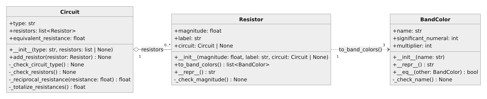
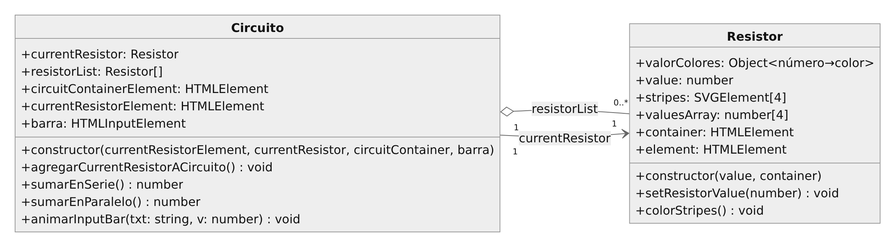
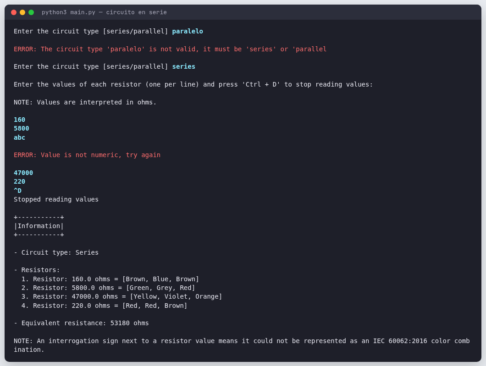
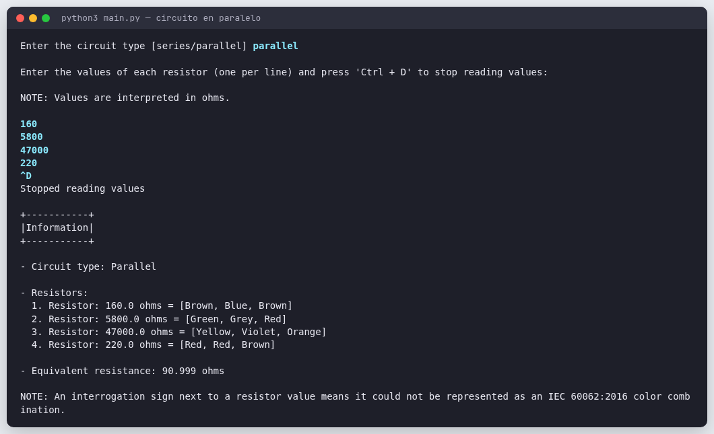
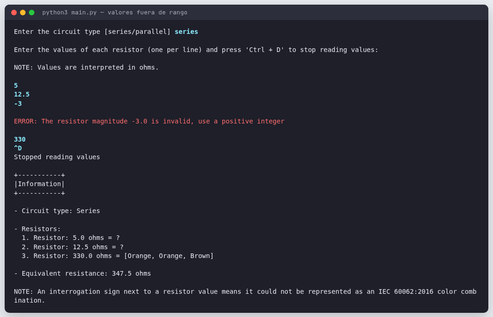
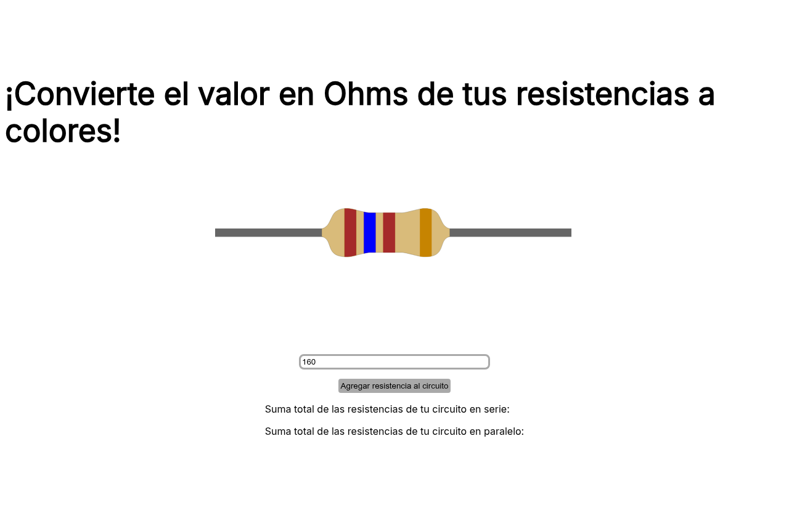
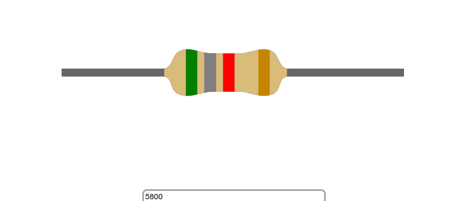
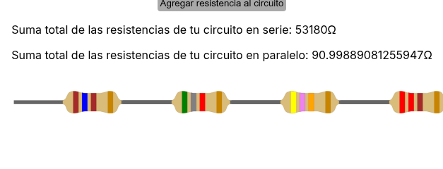

<div align="center">

**UNIVERSIDAD ANÁHUAC MAYAB**

# Proyecto 1 — Resistencia eléctrica

### Documentación del proyecto (PAIF)

**Estructuras de Datos y Algoritmos** · NRC 50560<br>
Estructura de datos: **Arreglos**

Docente: Lizbeth Hernández Olan

**Integrantes del equipo**<br>
Alejandro Cervera Castillo · Gael Hernández Lozano · Mario Andrés Zaldívar de la Cruz · Rodolfo Concha Canto

Mérida, Yucatán · Noviembre de 2026

</div>

---

## Índice

1. [Fase 1. Contextualización](#fase-1-contextualización)
2. [Fase 2. Requerimientos funcionales](#fase-2-definición-de-los-requerimientos-funcionales)
3. [Fase 3. Diseño](#fase-3-diseño)
4. [Fase 4. Codificación](#fase-4-codificación)
5. [Fase 5. Pruebas](#fase-5-pruebas)
6. [Referencias](#referencias)

---

## Fase 1. Contextualización

### ¿Qué se debe hacer?

Un programa que, a partir del valor de una resistencia en ohmios, obtenga la combinación de colores de sus bandas según la norma IEC 60062:2016. También debe calcular la resistencia equivalente de *n* resistencias conectadas **en serie** y **en paralelo**. El equipo hizo dos versiones con la misma lógica:

- **Versión de consola (Python):** lee el tipo de circuito y los valores de las resistencias. Imprime la combinación de colores de cada una y la resistencia equivalente.
- **Versión gráfica (HTML + JavaScript):** dibuja la resistencia con sus bandas coloreadas mientras el usuario escribe el valor. Permite agregar resistencias a un circuito y muestra los totales en serie y en paralelo.

### ¿Qué se necesita?

- Una clase que represente una **resistencia** y sepa convertir su magnitud en bandas de colores.
- Una clase que represente el **circuito**, guarde sus resistencias en un **arreglo** y calcule la resistencia equivalente con las fórmulas:
  - Serie: `Rts = R1 + R2 + … + Rn`
  - Paralelo: `Rtp = 1 / (1/R1 + 1/R2 + … + 1/Rn)`
- Una tabla de colores, modelada como arreglo, que relacione cada color con su dígito y su multiplicador.
- Validación de entradas: tipo de circuito válido, valores numéricos y no negativos.

### ¿Qué elementos se identifican?

| Elemento | Descripción |
|---|---|
| Valor de la resistencia | Magnitud en ohmios (Ω) que escribe el usuario. |
| Dígitos significativos | Los dos primeros dígitos del valor (1.ª y 2.ª banda). |
| Multiplicador | Potencia de 10 que representa la 3.ª banda (cantidad de dígitos restantes). |
| Tabla de colores | Negro (0, ×1) … Blanco (9, ×10⁹), guardada en un arreglo. |
| Combinación de colores | Arreglo de tres bandas que representa el valor. |
| Circuito | Tipo (serie o paralelo) y arreglo de resistencias. |
| Resistencia equivalente | Resultado de aplicar la fórmula del tipo de circuito. |
| Representación gráfica | Dibujo SVG de la resistencia con las bandas coloreadas (versión web). |

---

## Fase 2. Definición de los requerimientos funcionales

| ID | Requerimiento | Versión |
|---|---|---|
| R1 | Convertir el valor de una resistencia a colores | Consola y web |
| R2 | Mostrar los colores en modo gráfico | Web |
| R3 | Calcular la resistencia equivalente en serie | Consola y web |
| R4 | Calcular la resistencia equivalente en paralelo | Consola y web |
| R5 | Validar las entradas del usuario | Consola y web |

| | |
|---|---|
| **Nombre** | R1 – Convertir el valor de una resistencia a colores |
| **Descripción** | Toma los dos primeros dígitos del valor como 1.ª y 2.ª banda y la cantidad de dígitos restantes como multiplicador (3.ª banda). Cada número se busca en el arreglo de colores IEC 60062:2016. |
| **Entrada** | Valor en ohmios. Ej.: `160`, `5800`, `47000` |
| **Salidas** | Nombres de las bandas. Ej.: `160` → Marrón, Azul, Marrón; `5800` → Verde, Gris, Rojo; `47000` → Amarillo, Violeta, Naranja |

| | |
|---|---|
| **Nombre** | R2 – Mostrar los colores en modo gráfico |
| **Descripción** | Mientras el usuario escribe, la versión web colorea las cuatro bandas de un dibujo SVG. La cuarta banda (tolerancia) se pinta dorada o plateada según cuánto valor se pierde al redondear a dos cifras significativas. |
| **Entrada** | Valor en ohmios escrito en la barra |
| **Salidas** | Dibujo de la resistencia con sus bandas coloreadas |

| | |
|---|---|
| **Nombre** | R3 – Calcular la resistencia equivalente en serie |
| **Descripción** | Suma las magnitudes de todas las resistencias del arreglo del circuito: `Rts = R1 + R2 + … + Rn`. |
| **Entrada** | Tipo `series` y *n* valores (consola) o resistencias agregadas al circuito (web) |
| **Salidas** | Resistencia equivalente en Ω. Ej.: 160 + 5800 + 47000 + 220 = **53 180 Ω** |

| | |
|---|---|
| **Nombre** | R4 – Calcular la resistencia equivalente en paralelo |
| **Descripción** | Suma los recíprocos de las magnitudes y devuelve el recíproco de esa suma: `Rtp = 1 / (1/R1 + … + 1/Rn)`. No admite que todas las resistencias valgan 0 Ω, porque 1/0 no está definido. |
| **Entrada** | Tipo `parallel` y *n* valores (consola) o resistencias agregadas al circuito (web) |
| **Salidas** | Resistencia equivalente en Ω. Ej.: 160 ∥ 5800 ∥ 47000 ∥ 220 = **90.999 Ω** |

| | |
|---|---|
| **Nombre** | R5 – Validar las entradas del usuario |
| **Descripción** | Rechaza tipos de circuito distintos de `series`/`parallel`, valores no numéricos y valores negativos. Muestra un mensaje de error y vuelve a pedir el dato sin terminar el programa. Los valores que no se pueden representar con colores (menores a 10 Ω o con decimales) se marcan con `?`. |
| **Entrada** | `paralelo`, `abc`, `-3`, `5`, `12.5` |
| **Salidas** | `ERROR: The circuit type 'paralelo' is not valid…`, `ERROR: Value is not numeric, try again`, `ERROR: The resistor magnitude -3.0 is invalid…`, `5.0 ohms = ?` |

---

## Fase 3. Diseño

### Versión de consola (Python)



| Clase | Atributos | Métodos |
|---|---|---|
| **Circuit** | `type: str`<br>`resistors: list[Resistor]`<br>`equivalent_resistance: float` | `add_resistor(resistor)`<br>`_check_circuit_type()`<br>`_check_resistors()`<br>`_reciprocal_resistance(resistance) → float`<br>`_totalize_resistances() → float` |
| **Resistor** | `magnitude: float`<br>`label: str`<br>`circuit: Circuit \| None` | `to_band_colors() → list[BandColor]`<br>`_check_magnitude()`<br>`__repr__() → str` |
| **BandColor** | `name: str`<br>`significant_numeral: int`<br>`multiplier: int` | `_check_name()`<br>`__repr__() → str`<br>`__eq__(other) → bool` |

**Relaciones:** `Circuit` agrega de 0 a *n* objetos `Resistor` en el arreglo `resistors`. `Resistor` usa `BandColor` para construir el arreglo de tres bandas. No hay herencia.

### Versión gráfica (JavaScript)



| Clase | Atributos | Métodos |
|---|---|---|
| **Resistor** | `valorColores` (dígito → color)<br>`value: number`<br>`stripes: SVGElement[4]`<br>`valuesArray: number[4]`<br>`container`, `element` | `setResistorValue(number)`<br>`colorStripes()` |
| **Circuito** | `resistorList: Resistor[]`<br>`currentResistor: Resistor`<br>`circuitContainerElement`, `currentResistorElement`, `barra` | `agregarCurrentResistorACircuito()`<br>`sumarEnSerie() → number`<br>`sumarEnParalelo() → number`<br>`animarInputBar(txt, v)` |

---

## Fase 4. Codificación

### Tecnologías y archivos

| Versión | Archivos | Tecnologías |
|---|---|---|
| Consola | `version-cli/classes.py`, `main.py`, `user_input.py`, `pretty_print.py` | Python 3.14 (sin dependencias externas) |
| Web | `index.html`, `resistor.js`, `styles.css` | HTML5, CSS3, JavaScript (SVG) |

### Uso de arreglos

- El circuito guarda sus resistencias en un arreglo (`self.resistors` en Python, `this.resistorList` en JavaScript). Las sumas lo recorren.
- La tabla de colores es un arreglo de objetos `BandColor` (Python) o un objeto indexado por dígito (`valorColores`, JavaScript).
- La combinación resultante es un arreglo de tamaño fijo: `color_combination = [None, None, None]` en Python y `valuesArray = [d1, d2, multiplicador, tolerancia]` en JavaScript.

### Fórmulas

```python
# Serie y paralelo (Circuit._totalize_resistances)
match self.type:
    case "series":
        equivalent_resistance = sum(resistances)
    case "parallel":
        equivalent_resistance = 1 / sum(map(self._reciprocal_resistance, resistances))
```

```python
# Bandas (Resistor.to_band_colors): dos dígitos significativos + multiplicador
first_band = int(str(self.magnitude)[0])
second_band = int(str(self.magnitude)[1])
multiplier = 10 ** len(str(int(self.magnitude))[2:])
```

### Condicionales y validaciones

```python
if self.magnitude != round(self.magnitude):
    raise ValueError("... not supported for resistances with decimal points")
if self.magnitude < 10:
    raise ValueError("... not supported for resistances below 10 ohms")
if log10(multiplier) > 9:
    raise ValueError("... too big to be represented as an IEC-60062:2016 color combination")
```

```js
// Versión web: la cuarta banda indica si se perdió más del 5 % del valor al redondear
if (parseFloat(leftover) > parseFloat(numberString) / 20) { /* plateada */ } else { /* dorada */ }
```

### Documentación del código

Las clases de Python tienen *docstrings* con sus atributos, sus métodos públicos y sus limitaciones (por ejemplo, `Resistor` y `Circuit` en `classes.py`). La función de salida `pretty_print_circuit_information` documenta sus parámetros.

### Instalación y uso

**Consola**

1. Instale Python 3.14.
2. Entre a la carpeta `version-cli` y ejecute:

   ```shell
   python3 main.py
   ```

3. Escriba el tipo de circuito (`series` o `parallel`) y luego un valor por línea. Para terminar, presione `Ctrl + D`.

**Web:** abra `index.html` en el navegador o entre a la página publicada del proyecto. Escriba un valor y presione **Agregar resistencia al circuito**.

### Limitaciones

- No se convierten a colores los valores menores a 10 Ω ni los que tienen decimales (en consola se muestran con `?`).
- Se usan dos cifras significativas: un valor como 165 Ω se representa como 160 Ω (en la web, la cuarta banda plateada avisa que se perdió más del 5 %).
- No se aceptan prefijos (*kilo*, *mega*); el valor se escribe completo en ohmios.

---

## Fase 5. Pruebas

| Requerimiento | Prueba | Resultado esperado | Resultado | Evidencia |
|---|---|---|---|---|
| R1 | 160, 5800, 47000, 220 | Marrón-Azul-Marrón, Verde-Gris-Rojo, Amarillo-Violeta-Naranja, Rojo-Rojo-Marrón | ✅ Cumple | Fig. 1, 4 |
| R2 | Escribir 160 y 5800 en la web | Bandas coloreadas en el dibujo | ✅ Cumple | Fig. 4, 5 |
| R3 | Serie de los 4 valores | 53 180 Ω | ✅ Cumple | Fig. 1, 6 |
| R4 | Paralelo de los 4 valores | ≈ 90.999 Ω | ✅ Cumple | Fig. 2, 6 |
| R5 | `paralelo`, `abc`, `-3`, `5`, `12.5` | Mensajes de error / `?` sin cerrar el programa | ✅ Cumple | Fig. 1, 3 |

**Figura 1.** Consola: circuito en serie. Incluye un tipo de circuito inválido y un valor no numérico (R1, R3, R5).



**Figura 2.** Consola: el mismo conjunto de resistencias en paralelo (R4).



**Figura 3.** Consola: valores que no se pueden convertir a colores y valor negativo (R5).



**Figura 4.** Web: al escribir 160 se dibuja Marrón-Azul-Marrón (R1, R2).



**Figura 5.** Web: 5800 Ω se dibuja Verde-Gris-Rojo (R1, R2).



**Figura 6.** Web: circuito con 160, 5800, 47000 y 220 Ω. Totales en serie (53 180 Ω) y en paralelo (90.9989 Ω), iguales a los de la consola (R3, R4).



**Conclusión:** las dos versiones dan los mismos colores y los mismos totales para las mismas entradas, y los totales coinciden con el cálculo a mano.

---

## Referencias

- International Electrotechnical Commission. (2016). *IEC 60062:2016 — Marking codes for resistors and capacitors*. IEC.
- Wikipedia. (s. f.). *Electronic color code*. https://en.wikipedia.org/wiki/Electronic_color_code
- Python Software Foundation. (2026). *The Python Tutorial — Classes*. https://docs.python.org/3/tutorial/classes.html
- Mozilla. (2026). *MDN Web Docs — Array*. https://developer.mozilla.org/es/docs/Web/JavaScript/Reference/Global_Objects/Array
- Hayt, W. H., Kemmerly, J. E., & Durbin, S. M. (2019). *Análisis de circuitos en ingeniería* (9.ª ed.). McGraw-Hill.
